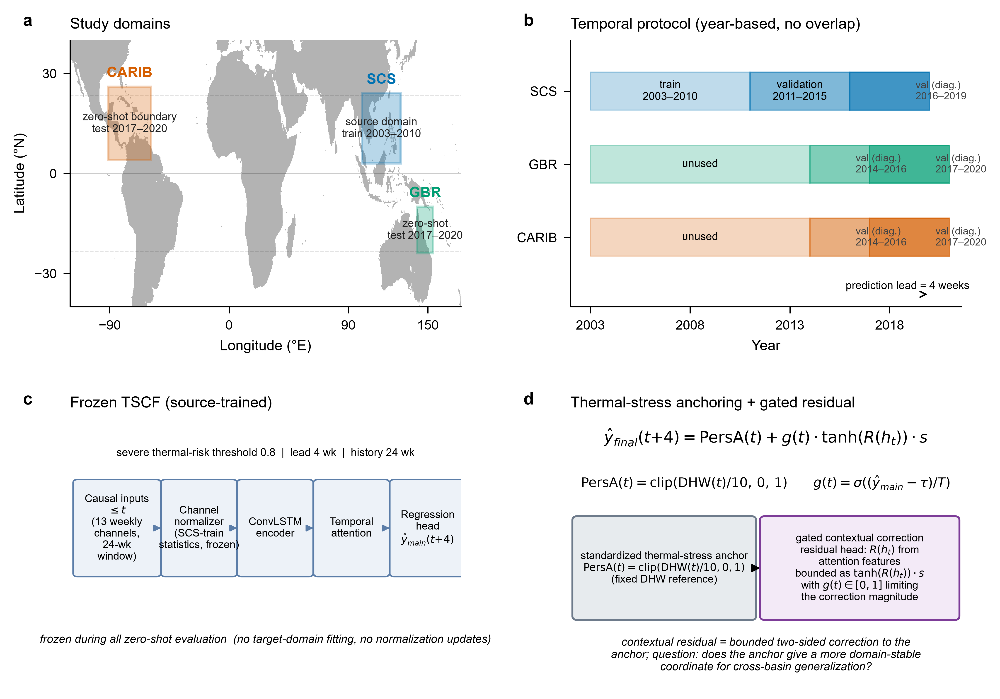
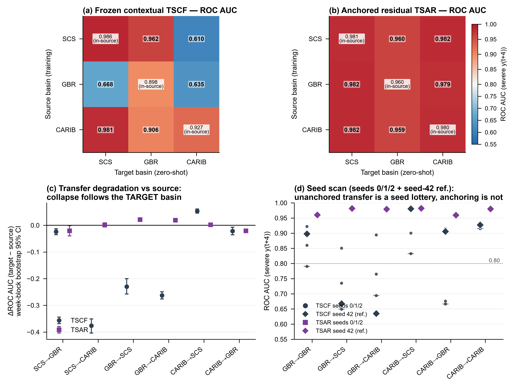
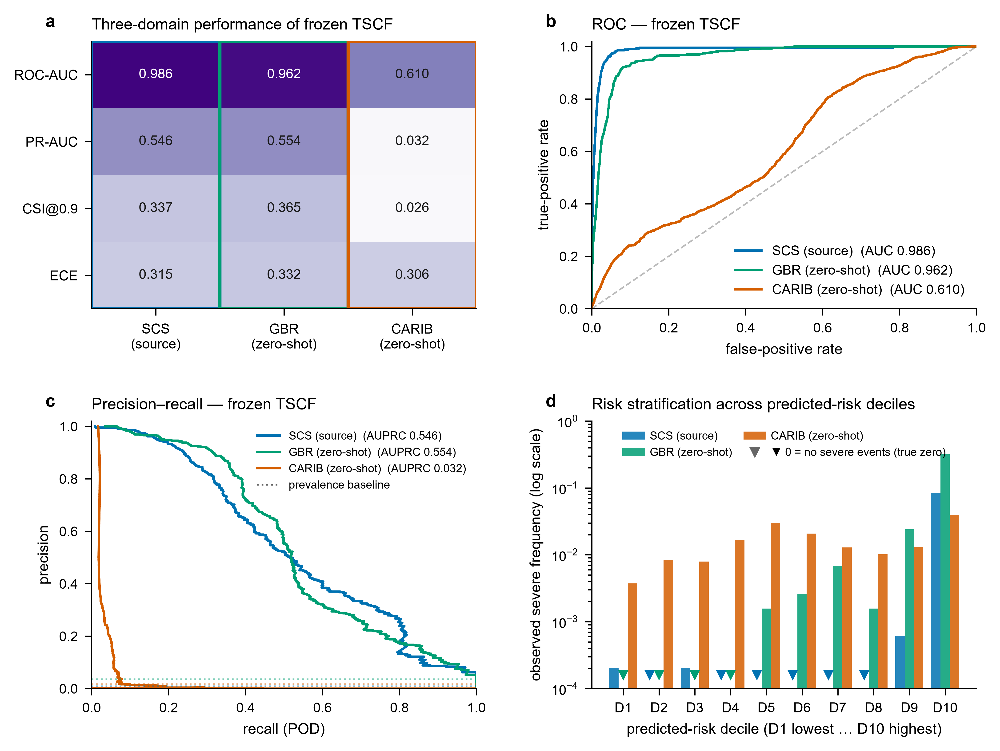
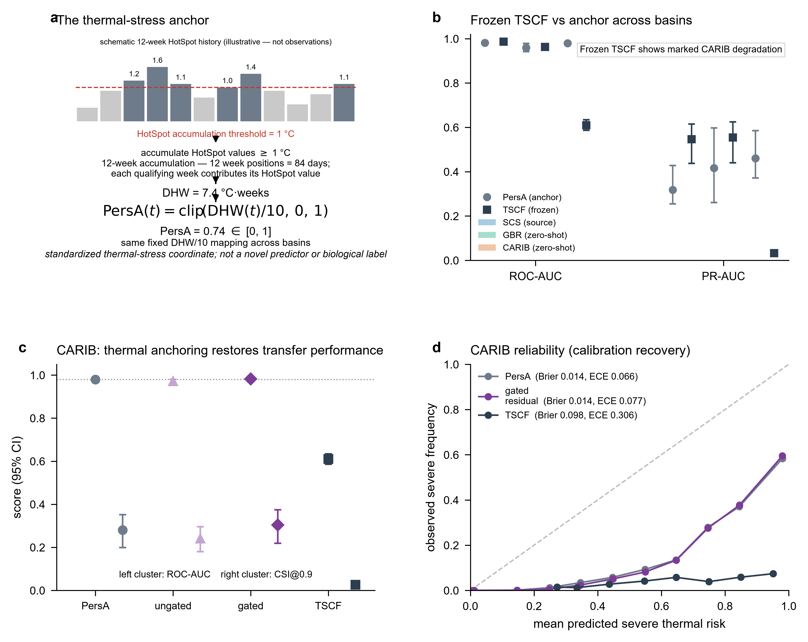
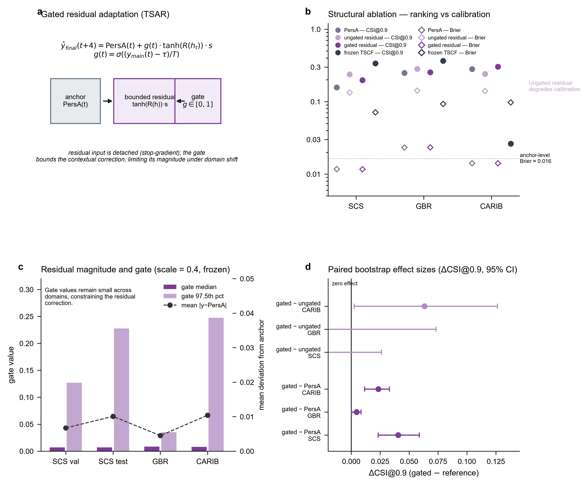
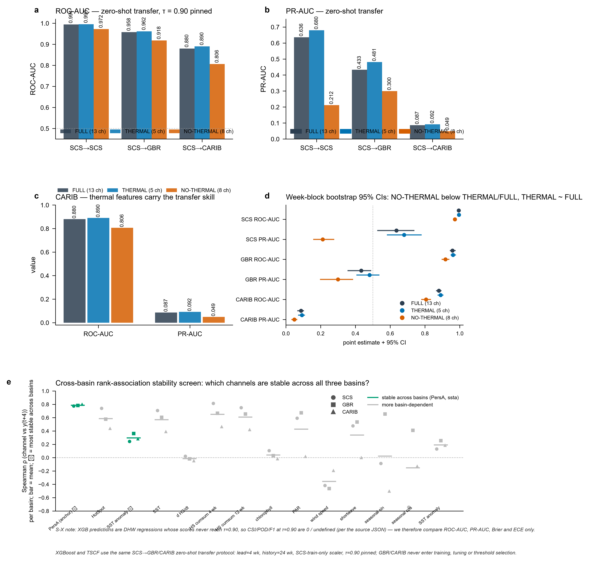
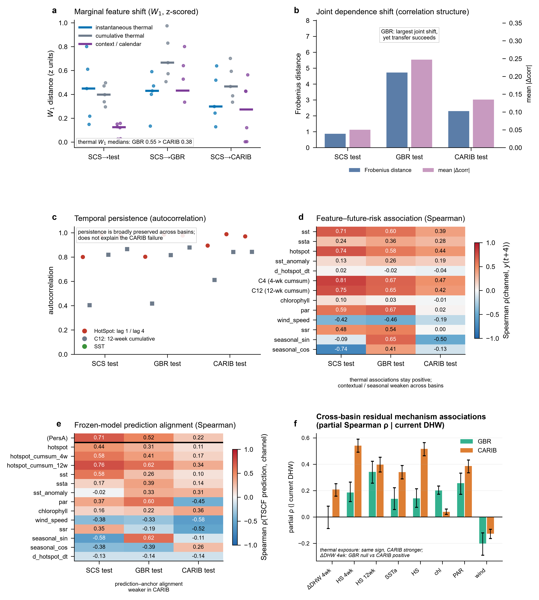
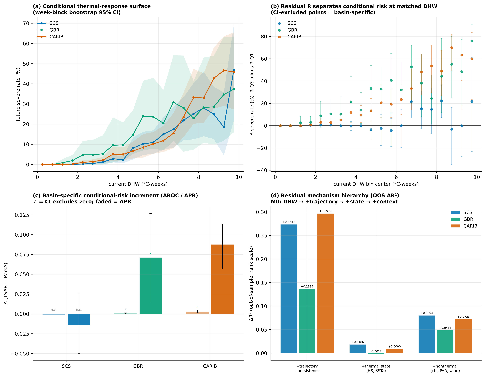
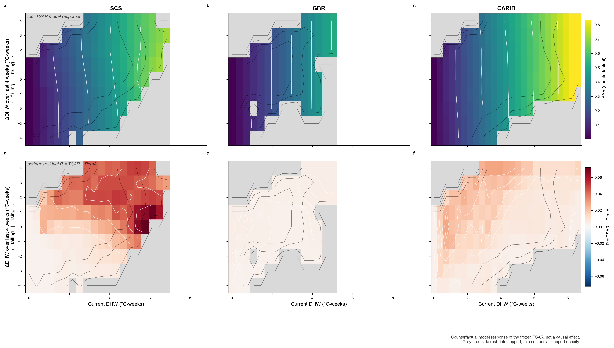
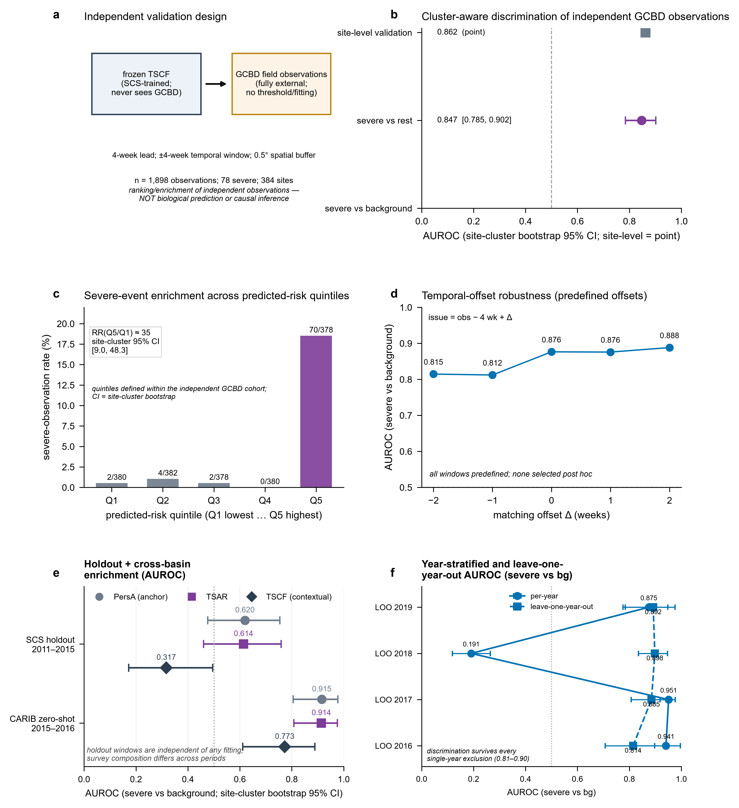

# Thermal-stress anchoring reveals transferable and basin-specific coral thermal risk

Bin Zeng, Rui Wang* & Houpu Li

Naval University of Engineering, Wuhan, China

*Correspondence: Rui Wang (1202152003@nue.edu.cn).

**ORCID iDs.** B.Z. 0009-0006-1165-2217; R.W. 0009-0009-5910-8415; H.L. 0009-0007-9500-7254.

**Author Contributions.** B.Z. conceived the experimental design, built the datasets and the causal data-construction pipeline, implemented and trained the models, designed and performed all experiments and statistical analyses, generated the figures and wrote the original draft. R.W. supervised the study, acquired and verified the thermal-stress and bleaching datasets, interpreted the cross-basin results and reviewed and edited the manuscript. H.L. verified the GCBD matching and the leakage audits, contributed to data quality control and figure preparation. All authors read and approved the final manuscript.

**Competing Interests.** The authors declare no competing financial or non-financial interests.

## Abstract

Single-route transfer tests conflate target difficulty with source-specific failure. We train a thermal-risk classifier and a gated anchored-residual variant across the South China Sea (SCS), Great Barrier Reef (GBR) and Caribbean (CARIB), evaluating all six transfer directions. The unanchored contextual representation is seed-fragile (up to 0.25 ROC AUC across seeds) and collapses in three of six directions (ROC AUC 0.61–0.67), whereas the physical anchor and the anchored variant remain stable (per-cell sd ≤ 0.003). At matched Degree Heating Weeks (DHW), future severe-risk rates differ among basins (3.5%, 1.6%, 0.9%), and the residual separates severe risk at matched exposure in GBR and CARIB but not in the source; XGBoost independently confirms this. Independent GCBD observations (n = 1,898) show severe-bleaching enrichment (cluster-aware AUROC 0.876, 95% CI 0.808–0.936; top-quintile rate ratio 35.2). Results are limited to three basins, within which anchoring provides a more stable transfer strategy than unanchored transfer.

## Introduction

Coral reefs face increasingly frequent and severe marine heatwaves [1,2,3] and a rapidly closing window for persistence under global warming [4]. Thermal stress disrupts coral--symbiont interactions and is a major proximate driver of bleaching [5], yet bleaching magnitude under comparable heat exposure varies among regions and years [6]: heat stress is necessary but not sufficient to explain the full biological response [7]. Satellite Coral Reef Watch (CRW) products provide spatially continuous estimates of accumulated thermal stress and are attractive targets for machine-learning early-warning systems [8,9]. Degree Heating Weeks (DHW) remains the operational measure of accumulated heat stress [10], and recent studies show both improving local prediction and geographically heterogeneous thermal-stress--bleaching relationships [11].

A central difficulty is **cross-domain transfer** [12,13,14,15,16]. A model trained in one basin may retain useful ordering information while its numerical scores or thresholded decisions become inappropriate elsewhere. Evaluation on accuracy, Critical Success Index (CSI) or F1 at one threshold mixes three distinct properties: ranking information, score-scale transfer, and correspondence to biological bleaching [17,18].

We treat thermal stress as a physically interpretable intermediate rather than learning bleaching probability from sparse observations. The DHW-derived coordinate defines the severe label (class-weighted
objective; 24-week history; four-week lead):
$$y(t) = \operatorname{clip}\!\left(\frac{\mathrm{DHW}(t)}{10},\,0,\,1\right) \in [0,1] \qquad (1)$$
where $\mathrm{DHW}(t)$ is the CRW Degree Heating Weeks at week $t$ and
$\operatorname{clip}(x,\,0,\,1) = \min(\max(x,\,0),\,1)$ bounds the
coordinate to the unit interval; the severe class is the indicator
$y(t+4) \ge 0.8$ (DHW $\ge$ 8 degree-weeks). The principal source is the South China Sea (SCS; 2003--2010 training, 2011--2015 validation, 2016--2019 testing); the same architecture is additionally trained with the Great Barrier Reef (GBR) and Caribbean (CARIB) as source (seed 42), yielding a **fully connected six-direction transfer matrix** in which every basin is evaluated zero-shot in every other basin and each basin's in-source performance is the diagonal reference.

We ask what part of the learned signal is genuinely transferable and what remains basin-specific. We map the complete transfer network; compare the learned model with a persistence anchor; introduce a gated, bounded residual correction; test whether the residual contains information beyond current DHW by conditioning on matched exposure; decompose its explanatory structure; and test architecture independence with feature perturbation, dependence-shift diagnostics and XGBoost. We do not call the method physics-informed machine learning in the strict sense: no governing equation or physical regularizer is imposed; physical knowledge enters through the DHW-derived coordinate and the explicit thermal feature group [19,20,21].

## Results

### Leakage-controlled learning

The model uses 13 dynamic environmental channels (SST, SSTA, HotSpot, chlorophyll, PAR, wind, shortwave radiation, seasonals, SST anomaly, HotSpot derivative, 4- and 12-week cumulative HotSpot). Normalization statistics are estimated from SCS training only and frozen (dataset scope, sample sizes: Supplementary Table 1; temporal-purge robustness: Supplementary Fig. 2). The leakage audit passed all causal checks (trailing cumulative windows, source-only normalization, target domains never altering weights or the threshold, GCBD excluded from the dense chain; Supplementary Fig. 1); the supplied static tensor is not consumed by the forward pathway, so no static-feature contribution is claimed (Fig. 1).

### A fully connected transfer matrix localizes collapse to the source--target pair

The single-route result cannot distinguish "the Caribbean is hard" from "the SCS-trained representation is context-dependent", so we completed the network: identical architecture and protocol retrained with GBR and CARIB as source, every model evaluated zero-shot everywhere (Methods; Supplementary Information R7).

**Transfer collapse follows the source--target pair at the reference seed (Fig. 2).** The frozen contextual TSCF fails in three of six directions: SCS→CARIB (ROC AUC 0.610), GBR→CARIB (0.635) and, unreported by any single-route design, GBR→SCS (0.668). The reverse directions succeed: SCS→GBR 0.962, CARIB→SCS 0.981 (above its own in-source 0.927) and CARIB→GBR 0.906. The pattern is asymmetric and pair-specific: CARIB as a target fails from every source, GBR as a source fails to every target, and CARIB as a source transfers successfully everywhere; no geographic-distance or target-difficulty account reproduces this structure.

The anchored formulations behave qualitatively differently. The persistence anchor (PersA) is stable in every cell (ROC AUC 0.959--0.982; source-independent by construction), and TSAR transfers with \|ΔROC\| ≤ 0.021 in all six directions (several deltas have bootstrap CIs excluding zero, none operationally meaningful). The instability is a property of the unanchored contextual representation, and is not a property of deep networks or of transfer per se: the same architecture, anchored to the same physical coordinate, survives every directed transfer that the unanchored representation fails. In-source contextual performance varies by source (SCS 0.986, CARIB 0.927, GBR 0.898), so the matrix is read relative to each row's own diagonal. A regime-confound test closes the remaining alternative reading at the seed-42 reference checkpoints (Supplementary Information R7): re-evaluated per target year, the CARIB-source models retain their ranking on the SCS mass-bleaching years 2016 and 2019 (TSCF ROC 0.971/0.975; TSAR 0.964/0.984), so the CARIB-source ranking success is not a low-severity-window artifact, the GBR-source contextual failure persists in the same years (TSCF ROC 0.725/0.485), and TSAR stays ≥ 0.96 in 27 of the 33 direction-year cells with a defined ROC (all six exceptions are GBR-target cells in 2017 and 2020, at 0.925–0.927; GBR-target 2019 is undefined because GBR records no severe events that year). Full matrices, PR AUC and audits: Supplementary Information R7. On the held-out SCS test set the frozen TSCF reaches ROC AUC 0.986, PR AUC 0.546, CSI@0.90 0.337 (Fig. 3); in GBR 0.962, 0.554, 0.365; in CARIB 0.610, 0.032, 0.026 (seed-42 checkpoint; Supplementary Methods S13; CARIB diagnostics: Supplementary Fig. 10).

**Seed fragility of the unanchored matrix.** Because the reverse-source rows are newly trained models, we retrained them across seeds 0--2 (Supplementary Information R7). The seed-42 matrix is a reference realisation, not a stable law: TSCF zero-shot outcome is seed-fragile in **every** direction: the same source→target pair spans up to 0.25 ROC AUC across seeds (CARIB→GBR: 0.915 / 0.666 / 0.676 for seeds 0 / 1 / 2), the seed-42 CARIB→GBR success (0.906) does not reproduce (0.67 at both re-seeds), and the pre-specified "GBR collapses everywhere / CARIB transfers everywhere" patterns each hold only in a subset of (seed, target) cells (five-seed audit: Supplementary Table 6). What is seed-invariant is the anchoring result: TSAR ROC 0.959--0.987 in every cell, per-cell sd ≤ 0.003, \|ΔROC\| ≤ 0.05 in 6/6 cells. The robust statement is therefore not which pair collapses at one seed, but that the unanchored contextual representation transfers unpredictably across basins and across seeds, while anchoring around the physical coordinate substantially reduces seed-to-seed variation in transfer performance. In the five-seed forward audit the GBR-versus-CARIB boundary direction is preserved in expectation by PR AUC (5/5 seeds) and CSI@0.90 (5/5), while per-seed ROC ranges widely (GBR 0.38--0.96, CARIB 0.46--0.73; boundary in 4/5).

### A DHW persistence anchor exposes the transferable thermal component

We define the physical anchor as the current-week thermal coordinate
(referred to as PersA_DHW in the code repository); it is not a predictor and
not a biological label, but a fixed, deterministic, seed-free reference:
$$\mathrm{PersA}_{\mathrm{DHW}}(t) = \operatorname{clip}\!\left(\frac{\mathrm{DHW}(t)}{10},\,0,\,1\right) = y(t) \qquad (2)$$
hereafter PersA. PersA remains highly rank-informative in all three domains (ROC AUC 0.982, 0.959, 0.979); in CARIB, where TSCF falls to 0.610/0.032, PersA reaches 0.979/0.460 (Fig. 4). The question becomes whether a learned representation can add information to a stable physical coordinate without sacrificing its transferability.

### Gated anchored residual learning restores CARIB transfer

We evaluate four variants: **A** PersA; **B** PersA plus a bounded ungated residual (gate ≡ 1); **C** PersA plus a bounded residual controlled by a thermal-risk gate; **D** the frozen contextual TSCF. The anchored formulation is
$$\widehat{y}(t) = \mathrm{PersA}(t) + g(t)\,r(t), \qquad
r(t) = s\,\tanh\!\left(R(h_t)\right), \qquad
g(t) = \sigma\!\left(\frac{y_{\mathrm{main}}(t) - \tau_g}{T}\right) \qquad (3)$$
where $\widehat{y}(t)$ is the final prediction at week $t$;
$\mathrm{PersA}(t)$ is the anchor of Eq. (2);
$r(t) \in [-s,\,s]$ is the bounded residual, produced by the residual head
$R(h_t) = \mathrm{MLP}_{\mathrm{sev}}(\mathrm{stopgrad}(A))$ applied to the
detached ConvLSTM representation $A = h_t$ (stop-gradient, so residual
gradients cannot update the backbone); $s = 0.4$ is the residual scale;
$g(t) \in (0,1)$ is the thermal-risk gate; $\sigma$ is the logistic
function; $y_{\mathrm{main}}(t)$ is the backbone severe-event probability;
and $\tau_g = 0.5$ and $T = 0.1$ are the gate threshold and temperature. The residual input is detached from the shared encoder, so the anchor is corrected conservatively rather than replaced (Fig. 5).

C reaches ROC AUC 0.981/0.960/0.982 and PR AUC 0.304/0.488/0.548 in SCS/GBR/CARIB, versus 0.982/0.959/0.979 and 0.318/0.416/0.460 for PersA. The CARIB gain is small in ROC AUC but larger in PR AUC and CSI. Under the paired week-block bootstrap (1,000 shared resamples, seed 42), the C−A contrast in CARIB is CI-supported for ΔROC (+0.0030; 95% CI \[+0.0013, +0.0046\]); the marginal per-model intervals overlap, so the paired shared-resample interval is the appropriate basis for model-difference inference (ΔPR \[+0.0569, +0.1135\]; ΔCSI@0.90 \[+0.0092, +0.0377\]; Supplementary Information S7, Supplementary Fig. 7, Supplementary Table 3). A spatial grid-cell cluster bootstrap (405 CARIB cells, 1,000 replicates, seed 42) leaves the gain CI-supported at similar magnitude, so the increment is robust to within-week spatial correlation. In the source domain, C does not improve ROC AUC (paired difference -0.0009 [-0.0027, +0.0011]) or PR AUC (-0.0141 [-0.0503, +0.0264]) over the anchor, but does improve thresholded CSI@0.90 (paired difference +0.0406 [+0.0186, +0.0633]); the gate’s benefit is therefore metric-dependent rather than a CARIB-specific rare-event effect alone. Across five seeds C stays at CARIB ROC AUC 0.979--0.982, and the gated-versus-ungated advantage (C−B) is CI-supported in all five seeds (Supplementary Fig. 8).

The ungated residual is unsafe: on CARIB, B−A has ΔROC ≈ −0.008 and ΔPR ≈ −0.072, with the continuous MSE up ≈ 0.123 and the score-reliability statistic up ≈ 0.348 (clipped convention used throughout); clipping the raw predictions to [0, 1] does not rescue the score–frequency agreement (the ungated variant retains MSE 0.133--0.137 and score reliability 0.41 after clipping, with only 0.7--5% of raw predictions exceeding 1.0), so the failure is a systematic mid-range score–frequency mismatch, not an out-of-range artifact. The gate limits how far the residual can move the anchor. Model D collapses in CARIB (D−A: ΔROC ≈ −0.369, ΔPR ≈ −0.428, ΔCSI ≈ −0.254). The recovery over D is carried by the anchor-plus-residual family: ungated B already restores CARIB ROC to 0.9714 versus 0.6101, and the gate's specific CI-supported contribution (C−B, +0.011 \[+0.006, +0.016\]) is the ranking increment relative to the ungated residual; the gate constrains the magnitude of the residual correction and limits departure from the physical anchor. Because TSAR is trained from scratch under a different objective, part of the C-versus-D difference reflects that change rather than anchoring alone (Methods).

### Thermal predictors carry the stable component

Feature ablations identify cumulative thermal exposure as the stable component. Removing the 12-week cumulative HotSpot channel costs GBR zero-shot ranking (ΔROC ≈ 0.041) but not SCS (≈ 0.004); removing all cumulative channels collapses GBR ranking (0.378 versus 0.956), while a thermal-only model preserves much of it (GBR 0.680, SCS 0.881): cumulative thermal channels are legitimate, transfer-bearing predictors under the CRW DHW definition, not shortcuts. Replacing the fixed cumulative channels with CRW-consistent trailing windows shows the canonical 12-week window is not dominant at a four-week lead [22] (best SCS rare-event performance PR AUC 0.599 at C4/C8; GBR best CSI@0.90 0.352 at C1) (Supplementary Figs. 3 and 4; consolidated per-basin values in Supplementary Table 10).

The environment-context permutation shows context channels contribute positively in SCS (ΔPR AUC ≈ +0.11, CI \[0.036, 0.191\]) but not for GBR zero-shot (ΔPR ≈ +0.011, CI including zero); applied to CARIB the same permutation does not degrade the already-poor ranking (ΔPR −0.003, CI [−0.008, +0.001]; ΔROC −0.053 [−0.087, −0.017], indicating permuting context improves the already-collapsed CARIB ranking). This direct test does not support attributing the CARIB failure to a rescuable context-channel signal; the CARIB contextual attribution is retained only at the associative level and the permutation evidence there is neutral (Supplementary Fig. 5, Supplementary Information S5, R3).

The independent eXtreme Gradient Boosting (XGBoost) control [23], trained on the same SCS-to-target logic with a 24-week flattened history and three feature selections, reproduces the pattern: on CARIB, ROC AUC 0.880 (FULL), 0.890 (THERMAL), 0.806 (NO_THERMAL); the week-block bootstrap confirms NO_THERMAL lies below THERMAL/FULL while THERMAL and FULL are statistically indistinguishable (Supplementary Table 5, Supplementary Information R4). XGBoost is a **continuous clip(DHW/10, 0, 1) regression** whose scores never reach the pinned τ=0.90: it verifies that thermal predictors carry the transferable ranking signal and does not validate thresholded severe-event detection or any operational claim (Fig. 6).

### Distributional and relational diagnostics

Marginal shift does not explain the transfer boundary. Mean standardized differences do not order the targets (instantaneous thermal: 0.402 SCS test, 0.202 GBR, 0.291 CARIB; cumulative thermal 0.710 GBR, 0.497 CARIB): the better-transferring basin can show equal or larger shift. Static correlation distance is larger for GBR than CARIB (Frobenius 4.722 versus 2.300), and temporal autocorrelation is preserved everywhere (12-week cumulative HotSpot lag-1 ≈ 0.985--0.989).

The discriminating view is the channel-to-future-target association (Fig. 7; numerical values in Supplementary Table 4). Cumulative HotSpot stays positively associated with the future target in all three domains (four-week ρ 0.814, 0.666, 0.467), whereas context and light variables show basin-specific sign changes or collapses (seasonal sine −0.088/+0.655/−0.499; PAR +0.593/+0.672/ +0.019; shortwave +0.476/+0.535/+0.003). The frozen TSCF prediction tracks the learned SCS joint structure in SCS and GBR but not CARIB (correlation with 12-week cumulative HotSpot 0.757, 0.625, 0.341), consistent with a representation-level account: the model learned a joint contextual pattern whose relationship to the future target changes across basins, while the thermal coordinate remains transferable.

### Conditional exposure-response heterogeneity reveals what the residual adds

The residual R = TSAR − PersA is interrogated in three linked ways (Fig. 8). First, a pre-registered training-free hierarchy separates current DHW, thermal trajectory/persistence, nonthermal context and R. Second, a direct conditional residual-information test compares PersA with TSAR on identical frozen records. Third, the response is conditioned on matched current-DHW bins so that residual-associated risk differences cannot be explained by the current thermal coordinate alone. All analyses are associative and representation-level; no target-domain fitting or threshold optimisation is used.

The conditional test identifies a target-specific increment beyond the thermal coordinate. Within 0.5 °C-week current-DHW bins supported by all basins, the future severe-event rate is higher for upper than lower residual tertiles in GBR (+0.047, 95% CI +0.027 to +0.064) and CARIB (+0.023, +0.015 to +0.030), but not SCS (+0.002, −0.002 to +0.005). The paired PersA-versus-TSAR test gives the same asymmetry: GBR ΔROC +0.0006 (95% CI +0.0002 to +0.0014) and ΔPR +0.0713 (+0.0149 to +0.1269); CARIB ΔROC +0.0030 (+0.0013 to +0.0046) and ΔPR +0.0877 (+0.0569 to +0.1135); SCS remains null. A fixed-DHW conditional-risk analysis independently shows pooled future severe-risk rates of 3.5%, 1.6% and 0.9% in GBR, CARIB and SCS, respectively, with CI-supported basin differences under the primary week-block bootstrap. The nested explanatory hierarchy shows that thermal trajectory/persistence explains much more residual variation than nonthermal context in the source, while target-domain residual variation is only partly recovered by explicit candidate variables. These tests collectively support a narrow interpretation: in the two transfer targets, R is associated with basin-specific conditional risk beyond current DHW; this does not establish a biological susceptibility mechanism or causality. A formal mechanism-discrimination framework (Supplementary Methods S14, Supplementary Table 9) tests two competing hypotheses. H1: the residual encodes source-local thermal trajectory. H2: the residual encodes basin-specific conditional risk information beyond current DHW. It applies three pre-specified criteria. The evidence matrix is consistent with H2 in the transfer targets (GBR and CARIB: partial association CI-positive and M2+R incremental gain True) while the source basin is more consistent with H1 (trajectory; M2+R gain False because the residual IS the trajectory in-source). These are statistical and model-representation interpretations, not evidence of a biological susceptibility mechanism. The GBR−CARIB pooled-gradient difference CI includes zero, so effect-size homogeneity is not established. A unified gated pipeline (Supplementary Table 9) further shows that thermal state (HotSpot, SST anomaly) does **not** incrementally explain GBR residual variance beyond trajectory/persistence (ΔR² −0.001, CI includes zero), while it does in SCS and CARIB; this is directionally consistent with the cross-basin mechanism analysis, in which GBR effect sizes are smaller and the 4-week DHW change is null in GBR (Supplementary Methods S14, Supplementary Table 9). A complementary counterfactual probe interrogates the frozen TSAR directly: (Fig. 9) at fixed current DHW, the recent thermal trajectory is perturbed on a common supported grid while nonthermal inputs remain observed (Methods; Supplementary Methods S14). The residual response to rapid-rise versus rapid-fall trajectories is positive where supported in CARIB (+0.020, median; +0.018 to +0.024). This is input--output evidence about the frozen model, not a causal effect on reefs; the intervention is not a physically self-consistent ocean state because HotSpot is linked to SST.

Two further enrichment probes bound the claim: in the 2011--2015 temporal holdout the anchor PersA retains enrichment (AUROC 0.62, CI excluding 0.5) while the contextual score does not (0.32, inverted), and in the CARIB 2015--2016 window the frozen SCS-trained anchor enriches independent field observations zero-shot at 0.915. The ecological instability pattern mirrors the transfer matrix and the seed scan (Supplementary Information R5).

### Independent bleaching observations: ecological consistency, not a bleaching model

Global Coral Bleaching Database (GCBD) observations are reserved for an independent validation layer [24]. The leakage-free SCS matching set contains 1,898 observations (530 any-bleaching, 78 severe at Percent_Bleaching ≥ 20%) (Fig. 10). The frozen thermal-risk score ranks severe observations well above background: cluster-aware AUROC 0.876 (95% CI 0.808--0.936) versus background, 0.847 (0.785--0.902) versus all others; Mann--Whitney p = 2.2e−29, Cliff's δ = 0.75. Any-bleaching discrimination is modest (AUROC 0.530), consistent with non-thermal processes dominating mild bleaching [25]. Severe events are enriched in the top predicted-risk quintile (rate 18.5% versus 0.5%; rate ratio 35.2, site-cluster CI 9.0--48.3), but the enrichment is concentrated in two high-stress years (74 of 78 severe in 2016 and 2019) and is predominantly a 2016 effect (within-year rate ratio 22.8 versus 1.29 in 2019; Supplementary Information R5); the quintile pattern is non-monotonic. Discrimination and enrichment strengthen with the severity threshold (AUROC 0.800/0.876/0.939 at ≥ 10/20/30%), and are robust to ±4-week matching offsets (AUROC 0.81--0.89) and reproduced at site level (site AUROC 0.86; site-preserving permutation p = 0.0005). **The enrichment is scoped to the 2016--2019 test window.** In a 2011--2015 temporal holdout the anchor PersA retains enrichment (AUROC 0.620 \[0.476, 0.754\]) while the frozen contextual TSCF does not (0.317 \[0.172, 0.495\], inverted), and in an independent CARIB 2015--2016 global-GCBD window the anchor and TSAR enrich strongly (0.915/0.914, RR ≈ 5.4) while TSCF is moderate (0.773), mirroring the transfer matrix and the seed scan (Supplementary Information R5).

The enrichment is carried by the shared thermal-risk coordinate, not by the contextual representation alone. Repeating the identical matching for PersA and TSAR on the like-for-like common cohort (n = 1,444, 28 severe) gives comparable enrichment across models (AUROC 0.82/0.83/0.81; Cliff's δ 0.65/0.66/0.63); TSCF's larger full-cohort values (0.876, rate ratio 35.2, n = 78) reflect coverage rather than stronger ranking, since PersA and TSAR are undefined on the 454 observations (50 severe) lacking a current-DHW anchor (Supplementary Information R5). Because the matched issue time is observation minus four weeks, part of the association reflects DHW persistence: the neural model adds no measurable ecological gain beyond the DHW coordinate on this check. The GCBD layer validates the thermal-risk coordinate, not biological prediction by the residual or the contextual representation.

## Discussion

A physically interpretable thermal coordinate survives basin changes more reliably than a learned contextual blend, but the new conditional analyses show that anchoring does not imply that all remaining information is noise. At matched current DHW, future severe thermal risk differs among basins [26], and the TSAR residual separates that conditional risk in both transfer targets. The residual therefore provides a bounded representation of basin-specific conditional risk information beyond the current thermal coordinate, while the source-basin null acts as a conservative control. This is an associative transfer result, not evidence of a biological susceptibility mechanism. Because future thermal risk is strongly autocorrelated with current DHW (weekly lag-1 autocorrelation of the cumulative channels exceeds 0.98 in all basins), part of any residual association may reflect DHW persistence rather than independent biological information; no experiment in this study isolates that component, and the residual contains information associated with future thermal risk conditional on the DHW-based anchor, not a verified biological signal.

The six-direction matrix changes the question from "does the model transfer?" to "what determines transferability?" A single route admits two readings; the seed-42 reference matrix shows an asymmetric pattern: CARIB is simultaneously the worst target and the best source, whereas GBR, the easiest SCS target, fails as a source. Because the reverse-source seed scan shows that these pair-specific outcomes are not stable laws, this pattern is interpreted as a reference realisation rather than a universal basin ranking. Collapse is a property of the learned source--target pair and has no analogue among the anchored formulations. The failure is not explained by marginal distance, static correlation or autocorrelation; the channel-to-future-target mapping is the discriminating view, and the residual decomposition adds an associative asymmetry: trajectory information in the source, matched-exposure severe-risk information in the targets. Contextual variables are not unimportant; their predictive meaning is basin- and pair-dependent [27]. The four-level mechanism decomposition adds a further nuance: in GBR, thermal-state channels (HotSpot, SST anomaly) provide no incremental explanation of residual variance beyond trajectory and persistence (ΔR² −0.001, CI includes zero), whereas they do in SCS and CARIB. This GBR thermal-state redundancy (the cumulative trajectory already encodes the instantaneous state) explains why GBR residual OOS R² is the lowest among the three basins without requiring weaker signal quality.

For operational programs the matrix carries a practical message. (1) Do not certify a model from one route: validate every deployment target under its own frozen-protocol holdout. (2) Anchor before you trust: if a learned score cannot beat PersA at matched exposure in the target, its contextual component is not transferring and the anchored score is the safe operational choice. (3) Validate and, where justified by independent target-domain data, select decision thresholds locally: τ=0.90 is a cross-domain reference, not an operational boundary. (4) Matched-exposure residual strata (Fig. 8c) detect whether a deployed model has learned target-specific conditional risk; in the source basin the null result is the expected signature of a source-fitted model. These are conditional-risk heuristics from the observed matrix, not a deployment study.

The XGBoost control confirms that thermal dependence is not confined to the ConvLSTM family; the agreement between model families supports the conclusion that thermal predictors contain the component of the signal that survives basin transfer. Because the regression objective is the same clip(DHW/10, 0, 1) coordinate that defines the PersA anchor, the tree ensemble’s reliance on thermal features makes it behave, in effect, like an unanchored model that has learned a coarse approximation of the anchor, which plausibly explains why it transfers where the contextual ConvLSTM does not. This interpretation concerns ranking of the continuous thermal-risk coordinate, not calibrated event probabilities. This aligns with the ecological literature in which accumulated thermal stress is a strong predictor and regional modifiers shape the response [28,29].

Across the six-direction network and the conditional-response analyses, the results are consistent with, and most simply explained by, the ordering: thermal stress → transferable risk coordinate; basin-specific environmental history/context → conditional modulation; bounded residual → conservative learned correction. We present this as a hypothesis generated from three basins and six directed transfers, not an established law. The mechanism chain is associative and representation-level, and additional independent reef systems would be required to test its generality.

The methodological lesson extends beyond coral bleaching: establish a leakage-free physical baseline; evaluate ranking separately from thresholded operation; test against the physical baseline; constrain learned corrections around the physical state; diagnose marginal and relational shift separately; and validate the transferable component against independent observations. Such a workflow can reveal whether an apparent transfer failure reflects representation instability, score-scale mismatch or both [18].

**Limitations.** (1) The network spans six directed transfers but still three basins; whether the collapse pattern generalises is open [30,31,32]. A within-SCS spatial holdout did not reproduce the cross-basin failure (held-out north band: spatial-holdout TSCF ROC 0.993, PR 0.519 versus PersA 0.993, 0.420; Supplementary Information R6), so the effect is cross-domain, not intra-basin spatial dependence. A three-seed scan of the reverse sources shows TSCF reverse-transfer outcomes are seed-fragile (same-pair ROC range up to 0.25) and the seed-42 pair-specific pattern does not fully reproduce across seeds; we therefore present the matrix as a reference realisation and rest the robust claim on the seed-invariant anchoring result. (2) Target-domain threshold adaptation is a supervised threshold-calibration analysis, not zero-shot prediction. (3) The joint-dependence analysis is associative. An alternative account of the CARIB collapse is regime or label scarcity (severe prevalence 0.016 versus 0.035 in GBR; no benchmark mass-bleaching year). Two regime controls address this directly (Supplementary Information R7): after subsampling both basins to a common severe prevalence (500 replicates, seed 42), the contextual ranking collapse persists in both matched regimes (TSCF ROC 0.610 versus 0.962 in each comparison), and a target-year stratification shows the CARIB-source ranking success persisting on the SCS mass-bleaching years (ROC 0.971/0.975) with the GBR-source failure persisting in the same years (0.725/0.485). Label scarcity therefore cannot explain either the ranking failure or the source asymmetry; the PR catastrophe, however, is partly prevalence-dependent (persisting at the low regime and inverting at the high regime), and the operational reading of PR in low-prevalence regimes should carry that caveat. (4) GCBD validation is sparse (78 severe, 74 of them in 2016 and 2019) and supportive rather than definitive. Year-stratified and leave-one-year-out re-analyses (Supplementary Information R5) show that severe-versus-background discrimination survives every single-year exclusion (AUROC 0.81--0.90), so the ranking signal is not an artifact of the 2016 concentration; the within-year top-quintile enrichment remains a 2016 phenomenon, and the biological validation should be read with that asymmetry. The matched-DHW estimates are likewise robust to spatial clustering (grid-cell bootstrap; Supplementary Methods S14), though the week-block bootstrap remains the primary inference basis. (5) The static tensor is unconsumed, so static-feature contribution and geographic memorization cannot be excluded. (6) Seed fragility is itself a finding: TSCF zero-shot transfer is seed-fragile in every direction while TSAR is seed-invariant (per-cell sd ≤ 0.003); the seed-42 checkpoint remains the evidence-locked reference, and the residual gain's CI status is seed-dependent (ΔROC positive in 4/5 seeds; PR in all as point estimate, though ΔPR is CI-supported in only 2/5 seeds (seeds 2 and 42)). (7) XGBoost is an architecture-independent control, not a benchmark of tree versus deep methods.

## Methods

**Data and protocol.** The source domain is the SCS (2003--2010 training, 2011--2015 validation, 2016--2019 testing); GBR and CARIB are evaluated under fixed transfer protocols. The lead is four weeks with 24 weekly observations of 13 dynamic channels (SST, SSTA, HotSpot, chlorophyll, PAR, seasonal sine, wind, shortwave radiation, SST anomaly, HotSpot derivative, 4- and 12-week cumulative HotSpot, seasonal cosine). Normalization statistics are computed from SCS training data only and reused unchanged.

**Thermal-risk target.** The coordinate $y(t)$ is defined in Eq. (1); it is a thermal-stress
severity coordinate, not bleaching percentage and not a biological
probability. TSCF trains on the severe-label indicator
$$\tilde{y}(t) = \mathbf{1}\{y(t+4) \ge 0.8\} \qquad (4)$$
using class-weighted binary cross-entropy (positive weight 1,000, sweep
selected on SCS validation only); the same coordinate defines PersA and the TSAR regression target. **Severe thermal risk is not severe bleaching**: severe thermal risk is y ≥ 0.8 (DHW ≥ 8 °C-weeks, CRW Alert Level 2), a satellite index, whereas severe bleaching is the GCBD field outcome Percent_Bleaching ≥ 20%. The 8 °C-week threshold is a fixed normalization of the training coordinate, not a biologically calibrated bleaching threshold; no operating threshold or calibration was derived from GCBD. Because the matched GCBD issue time is observation minus four weeks, part of the GCBD association reflects DHW persistence; the anchor, TSCF and TSAR enrich severe bleaching with indistinguishable AUROC (0.81--0.83) on shared observations, so the neural model adds no measurable ecological gain beyond the DHW coordinate (Supplementary Information R5).

**TSCF.** ConvLSTM encoder [33] with temporal self-attention [34] and a single multi-layer perceptron (MLP) sigmoid head $y_{main} = \sigma(MLP(A))$ outputting severe-event probability [35] (label y(t+4) ≥ 0.8), trained on SCS 2003--2010 only; normalization frozen from SCS training; frozen checkpoint = seed-42 reference.

**TSAR.** Learns a bounded correction around PersA using the formulation of
Eq. (3), with the residual head
$R(h_t) = \mathrm{MLP}_{\mathrm{sev}}(\mathrm{stopgrad}(A))$ and
stop-gradient detachment; the residual scale, gate threshold and
temperature are as in Eq. (3). The residual input is detached, so its gradients cannot alter the backbone; the correction is two-sided and bounded (±0.4) and in practice small. The model output is a bounded continuous thermal-risk score (anchor plus gated residual; nominally PersA +/- 0.4): it is not clipped in the model and is not interpreted as a calibrated probability. Two prediction tasks are evaluated separately. **Continuous thermal-risk estimation** applies to PersA, the ungated residual, TSAR and the XGBoost regressors: the target is the continuous coordinate y(t+4), and the metrics are the mean squared error (MSE; predictions clipped to [0, 1], with the raw-score MSE reported alongside), root-mean-square error, mean absolute error, R² and Spearman correlation. **Severe-event probability prediction** applies only to TSCF, whose sigmoid head is trained with weighted BCE on 1[y(t+4) ≥ 0.8]: the metrics are the binary Brier score, binary log loss, ECE, ROC AUC and PR AUC. ECE uses ten equal-width bins over [0, 1] with the last bin including 1.0, and the number of observations in every bin is reported. For the non-probability outputs (PersA, ungated residual, TSAR, XGBoost) the same binning statistic is reported as the **score reliability** (mean absolute deviation between the binned mean score and the observed severe-event rate) and is a descriptive score–frequency agreement, not a probability-calibration error. ROC AUC and PR AUC are rank-based and computed on raw scores (clipping would merge all super-threshold predictions into ties at 1.0 and destroy top-end precision information); CSI/POD/FAR/F1 binarize the raw score at the pinned τ = 0.90 and are threshold-dependent classification metrics, not pure ranking metrics. TSAR is trained from scratch on the same SCS data with a focal-MSE backbone term (γ = 0.5) [36] plus a λ_sev = 20 MSE term on the residual head, an objective different from TSCF's weighted BCE; part of the C-versus-D difference reflects this. Scale, gate threshold and temperature are frozen from SCS validation and never selected on GBR/CARIB (architecture, training protocol and evidence lock: Supplementary Table 2).

**Operational metrics.** ROC AUC, PR AUC, CSI, probability of detection (POD), false-alarm ratio (FAR) and F1 are reported for every model. Probability metrics — the binary Brier score, binary log loss and expected calibration error (ECE) — are reported only for TSCF, the only output that is a severe-event probability; for the continuous risk scores the corresponding descriptive statistic is the score reliability [37]. Ranking and threshold-dependent metrics are treated separately. τ=0.90 is a single, pre-fixed cross-domain operating point (threshold sensitivity: Supplementary Fig. 6), never selected on any target domain; any deployment in GBR or CARIB would require independent target-domain validation and threshold recalibration before its CSI/POD/FAR/F1 are interpreted as operational performance.

**Structural ablation.** A = PersA; B = ungated residual; C = gated anchored residual; D = frozen TSCF. Paired bootstrap uses 1,000 shared week-block resamples, seed 42 (the fixed seed of the original SCS protocol, set before any cross-domain evaluation; seeds 0--3 are reproducibility diagnostics [38,39]). The four primary contrasts (C−A, B−A, C−B, D−A) each isolate one architectural decision on a like-for-like record set; a paired shared-resample CI excluding zero is the evidence criterion, without a multiple-comparison correction over this small pre-specified set. Supporting/exploratory quantities should not be read in isolation. The week-block bootstrap addresses temporal dependence; the spatial grid-cell bootstrap (Supplementary Methods S7) addresses within-week spatial dependence; neither is the sole basis for a claim.

**Six-direction transfer matrix.** Each basin serves once as source and twice as zero-shot target; GBR- and CARIB-sourced models mirror the SCS architecture and protocol on their own causal v2 datasets (seed 42; no target-domain fitting or per-source tuning; the SCS-style channel normalizer is baked into every model, so no target scaler is fitted). In-source diagonals are each source model's own test evaluation; ΔROC = ROC(target) − ROC(own source) with paired week-block CIs (Supplementary Information R7).

Residual hierarchy and matched-DHW conditioning. (i) A pre-registered training-free hierarchy of percentile-rank scores (H0 = PersA; H1 = +ΔDHW_4w and 4/12-week HotSpot exposure; H2 = +chlorophyll, PAR, wind; H3 = +R) against severe y(t+4), with paired week-block CIs on shared resampled weeks. (ii) Out-of-sample explanation of R by fixed ordinary least squares (OLS) and rank-OLS, 5-fold GroupKFold by issue week, fold-internal preprocessing, pooled out-of-sample R², no tuning. (iii) Fixed current-DHW bins supported by all basins, outcome-free R tertiles within bins, and the Q3−Q1 severe-rate change pooled across bins with paired CIs. (iv) Basin-pair pooled risk differences and a logistic DHW×basin interaction. No threshold is optimised and no target-domain tuning is performed. A separate paired conditional residual-information test compares PersA directly with TSAR on the same frozen records and requires both a CI-supported incremental ROC/PR gain and a stable within-DHW residual association before labeling conditional information as established (Supplementary Methods S14, Supplementary Table 9).

**Counterfactual response surface.** On copies of real input windows, the anchor is set to a supported current-DHW level, the HotSpot channel rescaled to that level (preserving trajectory shape), a per-week offset (ΔDHW/28) applied over the last four weeks, cumulative channels shifted consistently and d_hotspot_dt recomputed; non-thermal channels remain at observed values. The frozen TSAR is evaluated on a (DHW, ΔDHW) grid restricted to cells with ≥ 100 real records (≤ 256 per cell; ±0.5 °C-week level, ±1.0 °C-week trajectory tolerances). Results are model-response surfaces, not causal effects. Because HotSpot is defined relative to SST, holding SST/SSTA fixed makes the counterfactual state physically self-inconsistent; the experiment probes the model's use of the trajectory channels only (Supplementary Methods S14).

**XGBoost control.** Trained on SCS only, evaluated zero-shot in GBR and CARIB; 24-week flattened history; three feature selections (all/thermal-only/no-thermal); continuous clip(DHW/10, 0, 1) objective. Read only through within-family contrasts; τ=0.90 metrics undefined and not interpreted. A record-set audit confirms exact population equivalence with the frozen TSCF on CARIB (n = 83,025; Supplementary Table 5, Supplementary Information R4).

**GCBD validation.** GCBD observations are matched to SCS test-period predictions with the established spatial and temporal protocol and are never used for training, dense target construction or threshold selection.

# Data availability

All analyses are based on the project's evidence-locked CRW, environmental and GCBD datasets and the documented preprocessing and evaluation scripts. Dataset identifiers: Global Coral Bleaching Database via BCO-DMO, https://doi.org/10.26008/1912/bco-dmo.773466.2; NOAA Coral Reef Watch 5 km daily products, https://coralreefwatch.noaa.gov/product/5km/; ESA OC-CCI chlorophyll via CEDA, https://archive.ceda.ac.uk/; NASA OceanColor Web MODIS-Aqua PAR, https://oceancolor.gsfc.nasa.gov/; ERA5 via Copernicus C3S, https://cds.climate.copernicus.eu/.

# Code availability

The complete self-contained reproduction package (source code, frozen model weights, shipped datasets, result files and figure-generation scripts) is provided with this manuscript as Supplementary Code. Before submission, replace this sentence with the permanent public repository URL and DOI: [INSERT VERIFIED PUBLIC REPOSITORY URL AND DOI].
# References

1.  Oliver, E. C. J. et al. Longer and more frequent marine heatwaves over the past century. *Nature Communications* 9, 1324 (2018). https://doi.org/10.1038/s41467-018-03732-9
2.  Frölicher, T. L., Fischer, E. M. & Gruber, N. Marine heatwaves under global warming. *Nature* 560, 360--364 (2018). https://doi.org/10.1038/s41586-018-0383-9
3.  Jacox, M.G. et al. Marine heatwaves and cold-spells in global coral reef zones. *Progress in Oceanography* 209, 102920 (2022). https://doi.org/10.1016/j.pocean.2022.102920
4.  Bozec, Y.-M. et al. A rapidly closing window for coral persistence under global warming. *Nature Communications* 16, 9704 (2025). https://doi.org/10.1038/s41467-025-65015-4
5.  Hughes, T. P. et al. Global warming and recurrent mass bleaching of corals. *Nature* 543, 373--377 (2017). https://doi.org/10.1038/nature21707
6.  Sully, S., Burkepile, D. E., Donovan, M. K., Hodgson, G. & van Woesik, R. A global analysis of coral bleaching over the past two decades. *Nature Communications* 10, 1264 (2019). https://doi.org/10.1038/s41467-019-09238-2
7.  Wyatt, A. S. J., Leichter, J. J., Washburn, L., Kui, L., Edmunds, P. J. & Burgess, S. C. Hidden heatwaves and severe coral bleaching linked to mesoscale eddies and thermocline dynamics. *Nature Communications* 14, 25 (2023). https://doi.org/10.1038/s41467-022-35550-5
8.  Cheung, M. W. M., Chaloupka, M., Hock, K. & Mumby, P. J. Moving beyond temperature metrics in coral bleaching prediction using interpretable machine learning. *Global Ecology and Biogeography* 34, e70105 (2025). https://doi.org/10.1111/geb.70105
9.  Maulidina, A. P., Mazel, K. & Manuaba, I. B. K. Predicting coral reef bleaching through machine learning. *2024 IEEE International Conference on Communication, Networks and Satellite (COMNETSAT)*, 364-368 (2024). https://doi.org/10.1109/comnetsat63286.2024.10862345
10.  Skirving, W., Marsh, B., De La Cour, J., Liu, G., Harris, A., Maturi, E., Geiger, E. & Eakin, C. M. CoralTemp and the Coral Reef Watch Coral Bleaching Heat Stress Product Suite version 3.1. *Remote Sensing* 12, 3856 (2020). https://doi.org/10.3390/rs12233856
11.  Mizuochi, H., Iguchi, A., Mizuyama, M., Iwao, K. & Yamamoto, S. Improved coral bleaching prediction using downscaled degree heating weeks derived from integrated thermal remote sensing products across multiple spatiotemporal scales. *PeerJ* 14, e21269 (2026). https://doi.org/10.7717/peerj.21269
12.  Ben-David, S. et al. A theory of learning from different domains. *Machine Learning* 79, 151--175 (2010). https://doi.org/10.1007/s10994-009-5152-4
13.  Meyer, H. & Pebesma, E. Predicting into unknown space? Estimating the area of applicability of spatial prediction models. *Methods in Ecology and Evolution* 12, 1620–1633 (2021). https://doi.org/10.1111/2041-210x.13650
14.  Ganin, Y. et al. Domain-adversarial training of neural networks. *Domain Adaptation in Computer Vision Applications*, 189–213 (2017). https://doi.org/10.1007/978-3-319-58347-1_10
15.  Tzachor, A., Devare, M., King, B., Arpin, E. & Kavallieros, N. Transfer learning in environmental remote sensing. *Remote Sensing of Environment* 295, 113924 (2024). https://doi.org/10.1016/j.rse.2023.113924
16.  Beery, S., Van Horn, G. & Perona, P. Recognition in terra incognita. *Computer Vision – ECCV 2018*, 472–489 (2018). https://doi.org/10.1007/978-3-030-01270-0_28
17.  Wilson, G. & Cook, D.J. A survey of unsupervised deep domain adaptation. *ACM Transactions on Intelligent Systems and Technology* 11, 1–46 (2020). https://doi.org/10.1145/3400066
18.  Lu, J., Liu, A., Dong, F., Gu, F., Gama, J. & Zhang, G. Learning under concept drift: A review. *IEEE Transactions on Knowledge and Data Engineering* 31, 2346–2363 (2019). https://doi.org/10.1109/tkde.2018.2876857
19.  Karniadakis, G. E. et al. Physics-informed machine learning. *Nature Reviews Physics* 3, 422--440 (2021). https://doi.org/10.1038/s42254-021-00314-5
20.  Karpatne, A. et al. Physics-guided neural networks. arXiv:1711.06164 (2017). https://doi.org/10.48550/arXiv.1711.06164
21.  Reichstein, M. et al. Deep learning and process understanding for data-driven Earth system science. *Nature* 566, 195–204 (2019). https://doi.org/10.1038/s41586-019-0912-1
22.  Whitaker, H. & DeCarlo, T. Re(de)fining degree-heating week: coral bleaching variability necessitates regional and temporal optimization of global forecast model stress metrics. *Coral Reefs* 43, 969--984 (2024). https://doi.org/10.1007/s00338-024-02512-w
23.  Chen, T. & Guestrin, C. XGBoost: A scalable tree boosting system. *Proceedings of the 22nd ACM SIGKDD International Conference on Knowledge Discovery and Data Mining*, 785--794 (2016). https://doi.org/10.1145/2939672.2939785
24.  van Woesik, R. & Kratochwill, C. A global coral-bleaching database, 1980--2020. *Scientific Data* 9, 20 (2022). https://doi.org/10.1038/s41597-022-01121-y
25.  Safaie, A. et al. High frequency temperature variability reduces the risk of coral bleaching. *Nature Communications* 9, 1671 (2018). https://doi.org/10.1038/s41467-018-04074-2
26.  Selmoni, O., Cleves, P. A. & Exposito-Alonso, M. Global coral genomic vulnerability explains recent reef losses. *Nature Communications* 17, 896 (2025). https://doi.org/10.1038/s41467-025-67616-5
27.  Xu, H. et al. Impacts of local anthropogenic stressors outpace those of climate on coral reef collapse in the northern South China Sea. *Nature Communications* 17, 4136 (2026). https://doi.org/10.1038/s41467-026-70760-1
28.  Lachs, L., Donner, S. D., Mumby, P. J., Bythell, J. C., Humanes, A., East, H. K. & Guest, J. R. Emergent increase in coral thermal tolerance reduces mass bleaching under climate change. *Nature Communications* 14, 4939 (2023). https://doi.org/10.1038/s41467-023-40601-6
29.  Humanes, A. et al. Selective breeding enhances coral heat tolerance to marine heatwaves. *Nature Communications* 15, 8703 (2024). https://doi.org/10.1038/s41467-024-52895-1
30.  Dixon, A.M., Donner, S.D., Webber, N.B. & Eakin, C.M. Future loss of local-scale thermal refugia in coral reef ecosystems. *PLOS Climate* 1, e0000004 (2022). https://doi.org/10.1371/journal.pclm.0000004
31.  Koh, P.W. et al. WILDS: A benchmark of in-the-wild distribution shifts. *Advances in Neural Information Processing Systems* 35 (2022). https://doi.org/10.52202/068431-0749
32.  Karpatne, A., Khandelwal, A. & Kumar, V. Machine learning for environmental science. *Environmental Data Science* 1, e2 (2022). https://doi.org/10.1017/eds.2022.2
33.  Shi, X., Chen, Z., Wang, H., Yeung, D.-Y., Wong, W.-K. & Woo, W.-C. Convolutional LSTM network: a machine learning approach for precipitation nowcasting. *Advances in Neural Information Processing Systems* 28 (2015). No DOI (conference proceedings).
34.  Vaswani, A. et al. Attention is all you need. *Advances in Neural Information Processing Systems* 30 (2017). No DOI (conference proceedings).
35.  Zadrozny, B. & Elkan, C. Transforming classifier scores into accurate probability estimates. *Proceedings of the eighth ACM SIGKDD International Conference on Knowledge Discovery and Data Mining*, 694--699 (2002). https://doi.org/10.1145/775047.775151
36.  Lin, T.-Y., Goyal, P., Girshick, R., He, K. & Dollár, P. Focal loss for dense object detection. *Proceedings of the IEEE International Conference on Computer Vision*, 2980--2988 (2017). https://doi.org/10.1109/ICCV.2017.324
37.  Guo, C., Pleiss, G., Sun, Y. & Weinberger, K. Q. On calibration of modern neural networks. *Proceedings of the 34th International Conference on Machine Learning*, PMLR 70, 1321--1330 (2017). No DOI (conference proceedings).
38.  Bouthillier, X. et al. Accounting for variance in machine learning benchmarks. *arXiv:2103.03098* (2021). https://doi.org/10.48550/arXiv.2103.03098
39.  Picard, D. torch.manual_seed(3407) is all you need: On the influence of random seeds in deep learning architectures for computer vision. *arXiv:2107.09027* (2021). https://doi.org/10.48550/arXiv.2107.09027
40.  Eakin, C. M. et al. Severe and widespread coral reef damage during the 2014--2017 Global Coral Bleaching Event. *Nature Communications* 17, 1318 (2026). https://doi.org/10.1038/s41467-025-67506-w
# Figure Legends

**Figure 1 |** Study design and the thermal-stress-anchored framework. (a) Study domains: SCS source domain and the GBR / CARIB zero-shot targets. (b) Year-based temporal protocol with a four-week forecast lead. (c) Frozen Thermal-Stress Context Fusion (TSCF) architecture: causal inputs, SCS-train-frozen channel normalizer, Convolutional Long Short-Term Memory (ConvLSTM) encoder and temporal attention, single severe-risk head. (d) Thermal-stress anchoring with a gated bounded residual (Thermal-Stress Anchored Residual, TSAR).

**Figure 2 |** Fully connected six-direction transfer matrix at the seed-42 reference checkpoints. (a) ROC AUC of the frozen contextual TSCF for every source (training basin) × target (zero-shot basin) pair; the diagonal is each model's in-source reference. (b) Same matrix for the anchored residual TSAR. (c) Transfer degradation ΔROC (target − source) with paired week-block bootstrap 95% CIs: TSCF collapses on 3/6 directed transfers (SCS→CARIB, GBR→CARIB, GBR→SCS) whereas TSAR stays within |ΔROC| ≤ 0.021 of its own source everywhere. (d) Seed scan per reverse-source direction (dots = seeds 0/1/2; diamond = seed-42 reference): the TSCF zero-shot outcome varies widely across seeds in every direction, whereas TSAR stays within a narrow band (per-cell sd ≤ 0.003). Unanchored transfer is strongly seed-sensitive, whereas anchoring substantially reduces seed-to-seed variation in the transfer outcome.

**Figure 3 |** Three-domain transfer boundary of the frozen TSCF. (a) Metric heatmap across SCS, GBR and CARIB (ROC-AUC, PR-AUC, CSI@0.9, ECE (probability)). (b) ROC curves. (c) Precision-recall curves. (d) Observed severe-event frequency by predicted-risk decile (log scale). Transfer failure is basin-specific rather than a uniform degradation with geographic distance.

**Figure 4 |** The thermal-stress anchor versus the frozen contextual model. (a) PersA definition (fixed DHW/10 mapping). (b) Frozen TSCF versus PersA across the three basins (95% CIs). (c) CARIB: PersA, un-gated residual, gated residual and frozen TSCF (ROC-AUC and CSI@0.9). (d) CARIB score–event-frequency agreement for PersA, the gated residual and the frozen TSCF. TSCF is a probability output, so its entry carries the binary Brier score and ECE; PersA and TSAR are continuous scores, so their entries carry the continuous MSE and a descriptive score-reliability statistic, not a probability-calibration error.

**Figure 5 |** Gated residual formulation and structural ablation. (a) TSAR formulation (anchor + gate\*bounded residual). (b) Structural ablation across domains: CSI@0.90 (threshold-dependent classification) versus continuous MSE; the un-gated residual has a 5.8–11.4-fold larger continuous error (basin-dependent) and a larger descriptive score–frequency disagreement (not a probability-calibration error). (c) Gate quantiles and mean deviation from the anchor (scale = 0.4, frozen). (d) Paired bootstrap dROC for gated-PersA and gated-ungated (95% CIs).

**Figure 6 |** Architecture-independent XGBoost thermal control. (a) ROC-AUC across SCS, GBR and CARIB for XGB_FULL, XGB_THERMAL and XGB_NO_THERMAL. (b) PR-AUC. (c) CARIB contrast in ROC-AUC and PR-AUC: the thermal-only variant is close to the full model, whereas removing thermal channels lowers ranking skill. XGBoost is a continuous DHW regressor, so probability-calibration metrics do not apply to it. (d) Marginal week-block bootstrap 95% CIs (1,000 resamples, seed 42) for ROC-AUC and PR-AUC in each domain: the NO-THERMAL interval lies below THERMAL and FULL in every domain and metric, while THERMAL and FULL overlap. (e) Cross-basin rank-association stability screen: per-channel Spearman rank correlation with y(t+4) in each basin; the physical anchor (PersA) and SST anomaly show the most stable cross-basin rank associations (★) (cross-basin association-stability analysis; distinct from the channel–future-target association in Fig. 7d) while nonthermal channels are more basin-dependent. CSI/POD/F1 are not shown because the DHW-regression scores never reach the pinned τ=0.90; continuous MSE is reported in the source data and is a regression error, not a Brier score.

**Figure 7 |** Distributional and relational domain-shift diagnostics. (a) Marginal feature shift (W1). (b) Joint correlation-structure shift. (c) Temporal persistence (lag-1/lag-4). (d) Feature-future-risk association (formal J2, Spearman). (e) Frozen-model prediction alignment (formal J4). (f) Cross-basin residual mechanism partial associations (| current DHW): thermal exposure channels show the same sign in GBR and CARIB but heterogeneous magnitude (CARIB stronger), while ΔDHW 4-week is not consistent (null in GBR). None of the marginal/joint/temporal diagnostics rank-orders the transfer outcome; the relational mapping is the discriminating view. Spatial maps: Supplementary Fig. 9.

**Figure 8 |** Conditional thermal-response surface and residual-associated conditional risk. (a) Future severe-thermal-risk rate as a function of current DHW, with week-block bootstrap 95% CIs. (b) Residual-associated conditional-risk difference at matched current-DHW bins (upper minus lower residual tertile). (c) Residual-associated conditional-risk increment: ΔROC/ΔPR for TSAR versus PersA; the reference-seed paired comparisons are CI-supported in GBR and CARIB but not SCS. (d) Nested out-of-sample residual-mechanism decomposition, with incremental explanatory variance from thermal trajectory/persistence, thermal state and nonthermal context. The figure synthesizes the pre-registered matched-DHW, conditional-residual and mechanism-decomposition analyses; all associations are representation-level and no target-domain fitting is performed.

**Figure 9 |** Counterfactual thermal-response surfaces of the frozen TSAR. Top: TSAR response (x = current DHW, y = ΔDHW over the last four weeks); bottom: residual R = TSAR − PersA. Grey areas lie outside real-data support; thin contours show support density. Unified colour scales across basins. Counterfactual model response, not a causal effect and not a physically self-consistent ocean state (SST/SSTA held fixed).

**Figure 10 |** Independent ecological validation against GCBD observations. (a) Validation design (frozen TSCF risk applied to external GCBD observations). (b) Cluster-aware discrimination of severe observations (site-cluster 95% CIs; site-level point estimate shown for reference). (c) Severe-event enrichment across predicted-risk quintiles. (d) Temporal-offset robustness. (e) Holdout + cross-basin enrichment forest: in the SCS temporal holdout 2011--2015 (n 1,993; 38 severe) the anchor persists (PersA 0.620) while the contextual TSCF inverts (0.317); in the CARIB zero-shot window 2015--2016 (388 window-matched observations, 188 severe; the anchor is defined on 264 of them, 119 severe; the 2015 mass-bleaching year [40]) the anchor is strongest (0.915). (f) Year-stratified and leave-one-year-out AUROC: severe-vs-background discrimination survives every single-year exclusion (0.81--0.90), which confirms that the ranking signal is not a 2016-concentration artifact.

