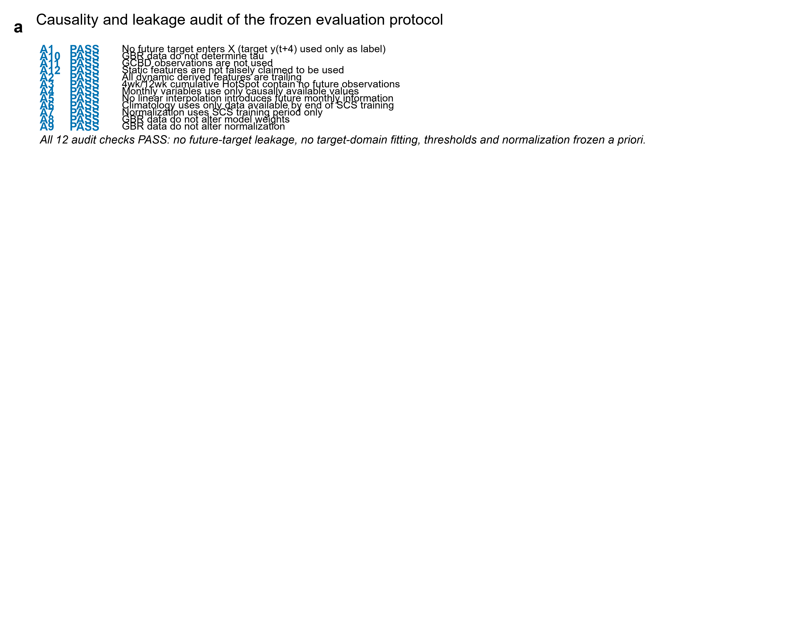
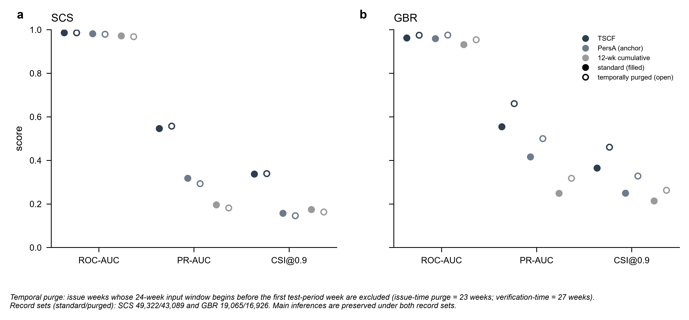
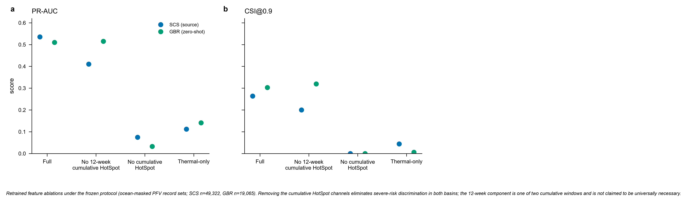
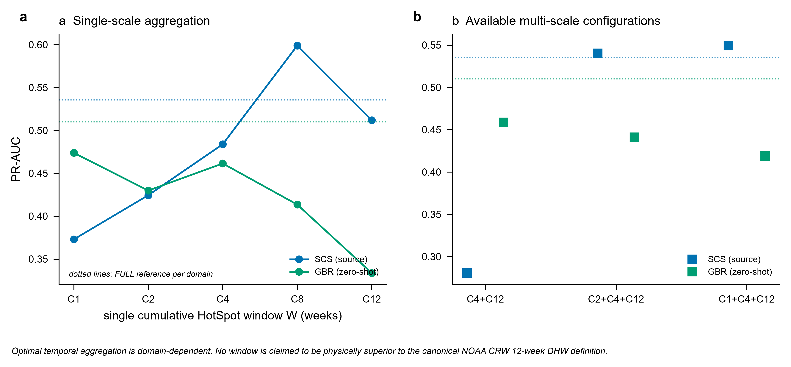
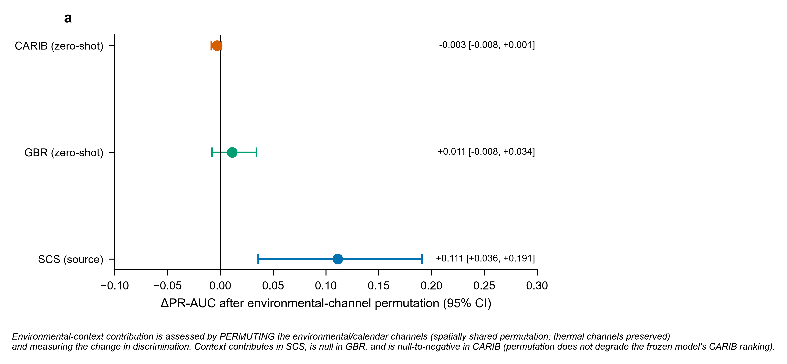
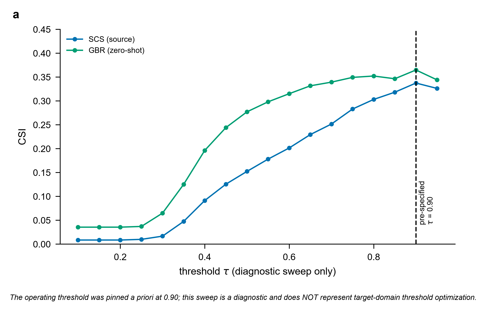
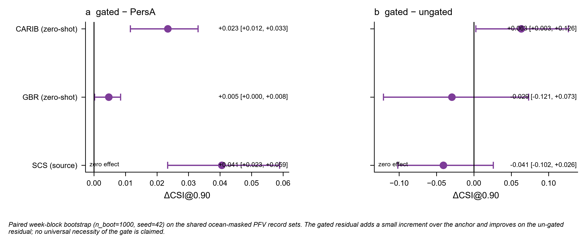
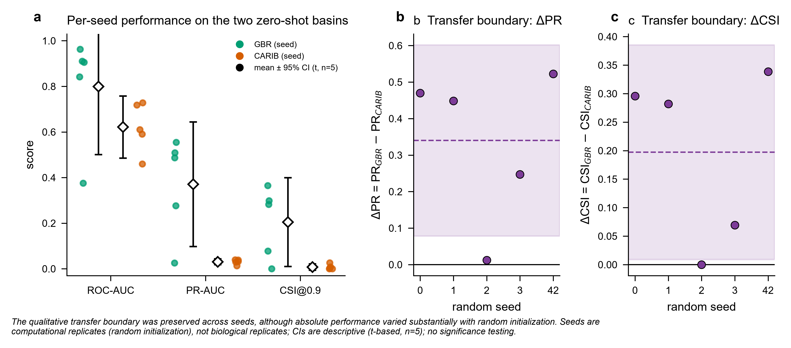
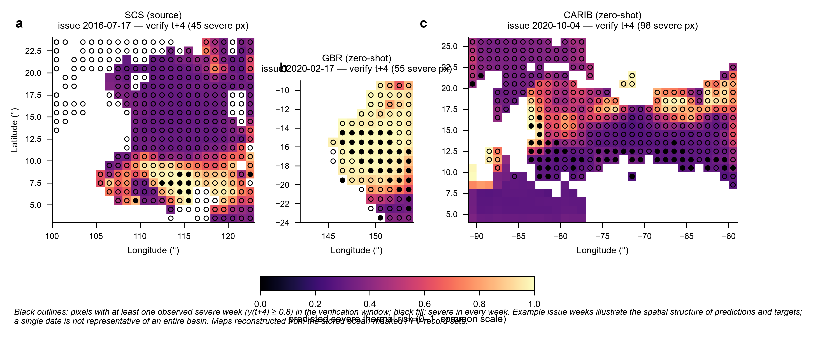
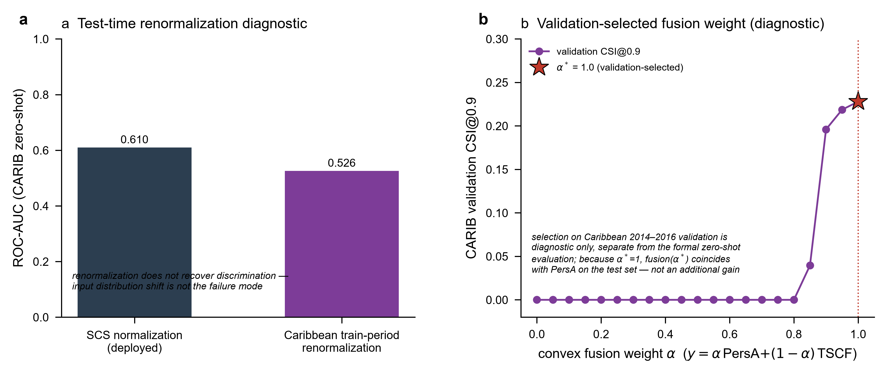

# Supplementary Information

# Thermal-stress anchoring reveals transferable and basin-specific coral thermal risk

## Supplementary overview

This Supplementary Information documents the leakage audits,
temporal-purge checks, feature ablations, temporal-scale experiments,
contextual attribution, threshold sensitivity, bootstrap uncertainty,
seed sensitivity, spatial diagnostics, CARIB-specific diagnostics and
hyperparameter/evidence locking.

Each item below states a main-text claim and the supplementary evidence that verifies it (Notes R = verification evidence; Tables = numerical records; Figs = audit and sensitivity displays):

- Causality and leakage control - S1, Note R1, Supplementary Fig. 1, Table 1.
- Temporal-purge robustness - S2, Supplementary Fig. 2, Table 1.
- Predictor-group support (thermal vs contextual) - S3, S5, Note R3, Supplementary Figs. 3 and 5, Table 4.
- Temporal accumulation scales - S4, Supplementary Fig. 4.
- Threshold sensitivity - S6, Supplementary Fig. 6.
- Structural contrasts and their uncertainty - S7, Note R2, Supplementary Fig. 7, Table 3.
- Seed sensitivity - S8, Note R7, Supplementary Fig. 8, Table 6.
- Spatial structure - S9, Supplementary Fig. 9.
- CARIB failure diagnostics - S10, Note R3, Supplementary Fig. 10, Table 4.
- Architecture-independent XGBoost verification - S12, Note R4, Table 5.
- GCBD validation and its robustness - Note R5, Supplementary Table 8.
- Consolidated per-basin numerical records cited in the main text - Supplementary Table 10.
- Residual information, mechanism and susceptibility - Methods S14, Supplementary Table 9.

------------------------------------------------------------------------

# Supplementary Methods

## S1. Causal data construction and leakage audit

The forecasting target is y(t+4), while every dynamic predictor
available at time t is constructed only from information at or before t.

The audit verifies:

-   no future target enters X;
-   d_hotspot_dt is causal;
-   four- and twelve-week cumulative HotSpot windows are trailing;
-   monthly variables use causally available observations;
-   no future information is introduced by interpolation;
-   climatological information is restricted to the source-domain
    training cutoff;
-   normalization statistics are calculated from SCS training data only;
-   GBR and CARIB data do not update weights;
-   target-domain data do not determine the principal source threshold;
-   GCBD observations do not enter dense target construction;
-   the supplied static tensor is not consumed by the TSCF forward path.

**Supplementary Fig. 1 \| Leakage audit.**\
All specified causal checks are reported with PASS/FAIL status and the
corresponding code/data evidence.

The current audit passed all specified checks.

## S2. Temporal-purge sensitivity

To test whether nearby forecast windows create optimistic dependence,
the evaluation is repeated with temporal purge. The purged SCS and GBR
results remain qualitatively consistent with the standard protocol. For
example, GBR TSCF ROC AUC is 0.975 under the purged protocol versus
0.962 under the standard protocol, while PersA remains near 0.976 and
0.959, respectively.

**Supplementary Fig. 2 \| Temporal purge robustness.**\
Compare standard and purged protocols for TSCF and the physical persistence
baselines using ROC AUC, PR AUC, CSI, POD and FAR; continuous MSE and score
reliability for the persistence baselines, and binary Brier and ECE for TSCF.

## S3. Feature ablation

Feature ablations compare full input (FULL), removal of the twelve-week
cumulative exposure (NO_CUMSUM12), removal of all cumulative exposure
(NO_CUMULATIVE), and thermal-only input (THERMAL_ONLY) for the frozen
TSCF architecture, on SCS and GBR. The purpose is to distinguish ranking
information from the ability to cross the operational threshold.

The results show that thermal information contributes substantially to
ranking, while the full contextual representation contributes to the
score range and operating behaviour.

**Supplementary Fig. 3 \| Feature ablation and thermal dependence.**

## S4. Temporal-scale analysis

Single-scale cumulative exposure variants are compared with multi-scale
combinations. Four-week cumulative HotSpot provides a particularly
stable predictive component, while combining several scales does not
guarantee improved cross-domain performance.

**Supplementary Fig. 4 \| Temporal-scale ablation.**

## S5. Context attribution

Permutation attribution of contextual variables is evaluated separately
in SCS, GBR and CARIB. Mean changes in ROC AUC, PR AUC and CSI are
reported with bootstrap confidence intervals.

Status: positive in SCS (ΔPR AUC ≈ +0.11, CI [0.036, 0.191]); null in GBR
(ΔPR AUC ≈ +0.011 [−0.008, +0.034]); and **null-to-negative in CARIB**.
For the frozen TSCF on CARIB (n = 83,025, severe = 1,356), spatially
permuting the environment/calendar channels (K = 100, seed 42) does not
degrade ranking: ΔPR AUC −0.003 [−0.008, +0.001] (includes zero), ΔCSI@0.9
+0.010 [+0.002, +0.016], and ΔROC AUC −0.053 [−0.087, −0.017] (a small ROC
*increase*, because the already-collapsed CARIB ranking depends negatively
on the randomized context). Environmental context therefore contributes no
positive ranking signal for the frozen model in any external basin, and in
CARIB the permutation evidence is neutral rather than supportive of a
context-driven transfer failure.

**Supplementary Fig. 5 \| Context-variable attribution.**

The interpretation remains associational. A positive permutation effect
indicates dependence of model performance on the feature, not a causal
environmental effect.

## S6. Threshold sensitivity

A diagnostic threshold sweep is reported for the frozen TSCF (SCS and
GBR). The source operating point is τ=0.90 pinned a priori; no
target-domain threshold adaptation is performed.

**Supplementary Fig. 6 \| Threshold sensitivity.**

This figure is important because threshold-dependent metrics can change
substantially even when ranking metrics remain nearly unchanged.

## S7. Bootstrap effect sizes

Paired week-block bootstrap with a shared resampling matrix is used for
structural comparisons. The principal contrasts include:

-   ungated residual versus PersA;
-   gated anchored residual versus PersA;
-   gated anchored residual versus ungated residual;
-   frozen TSCF versus PersA;
-   frozen TSCF versus anchored residual.

**Supplementary Fig. 7 \| Paired bootstrap effect sizes.**

For CARIB, the anchored residual improves over PersA by approximately
+0.003 ROC AUC, +0.088 PR AUC and +0.023 CSI@0.90. The ungated residual
is worse than PersA in ROC AUC and PR AUC and has a substantially larger
continuous MSE and worse score reliability.

**Marginal versus paired inference (primary/supporting).** The four
structural contrasts (anchored−PersA, ungated−PersA, anchored−ungated,
TSCF−PersA) are the *primary* comparisons; their paired-difference
95% CIs (Supplementary Table 3) are the primary basis for model-difference
inference. Marginal per-model 95% CIs (Supplementary Table 3b) are reported for
transparency: their overlap between C and A in CARIB is the conservative
reading and is not the appropriate criterion under the shared-resample
design. No large multiple-comparison correction is applied to this small,
pre-specified contrast set; individual exploratory metrics should not be
read in isolation.

**Spatial-cluster robustness of the CARIB C−A contrast (P1-7).** The
week-block bootstrap above resamples whole *weeks* and therefore does not
directly account for spatial dependence among pixels within a week. As a
robustness analysis (not a replacement for the week-block confidence
interval), we re-bootstrapped the CARIB C−A contrast at the **spatial
grid-cell** level: the 83,025 CARIB records are clustered into 405 unique
ocean grid cells (i, j), grid cells (not weeks) are resampled with
replacement (1,000 replicates, seed 42), and the paired C−A differences
are recomputed per replicate while preserving each cell's within-cell
(over time) sequence. The CARIB C−A gain remains CI-supported under this
spatial clustering: ΔROC +0.0030 [0.0023, 0.0037], ΔPR +0.0877
[0.0734, 0.1015], ΔCSI@0.90 +0.0234 [0.0172, 0.0292], all excluding zero.
The anchored-residual improvement over PersA in CARIB is therefore not an
artifact of within-week spatial correlation at the inference level.

## S8. Seed sensitivity

Five seeds (0, 1, 2, 3 and 42) were evaluated for the historical TSCF
checkpoint sensitivity analysis. The seed results are highly variable.
For example, GBR PR AUC ranges from approximately 0.026 to 0.554, while
CARIB PR AUC ranges from approximately 0.014 to 0.039 in that audit;
the GBR-versus-CARIB boundary is preserved in expectation by PR AUC
(ΔPR = PR_GBR − PR_CARIB > 0 in 5/5 seeds, range +0.01 to +0.52) and by
CSI@0.90 (ΔCSI ≥ 0 in 5/5 seeds), with the ROC-AUC boundary holding in
4/5 seeds.

The anchored residual (TSAR, model C) was additionally retrained with
the same five seeds (scale = 0.4, otherwise identical protocol). In
CARIB, C reaches ROC AUC 0.979–0.982 and PR AUC 0.475–0.548 across
seeds, well above the frozen contextual model (ROC 0.610) and, in every
seed, at or near the PersA anchor (ROC 0.979, PR 0.460; seed 3 ROC
0.9788 is marginally below the anchor 0.9792, so "at or near" is the
accurate phrasing).
The paired-difference CI of C−A in CARIB excludes zero on the positive
side in 4 of 5 seeds (the formal seed-42 estimate is +0.0030 [0.0013,
0.0046]); one seed shows a small CI-significant negative (seed 3,
≈ −0.0004). The direction of the anchored-residual gain is therefore
stable as a point estimate across seeds, while its CI-supported status
is seed-dependent: ΔCSI is CI-supported (positive) in 5/5 seeds, ΔROC
in 4/5, and ΔPR in 2/5. By contrast, the gated-versus-ungated advantage
(C−B) in CARIB is CI-supported in all five seeds (ΔROC positive, CI
excluding zero in 5/5), so the gate's protective role against the
ungated residual's score–frequency mismatch is the seed-robust result.

**Supplementary Fig. 8 \| Seed sensitivity.**

We report this variability explicitly. The formal seed-42 checkpoint should
be treated as an evidence-locked reference model rather than as proof of
universal optimization robustness. The seed analysis is therefore a
reproducibility diagnostic and a limitation of the current study.

## S9. Spatial transfer maps

Spatial maps display predicted thermal-risk patterns across SCS, GBR and
CARIB. The purpose is descriptive: to determine whether transfer failure
or anchor recovery has recognizable spatial organization.

**Supplementary Fig. 9 \| Spatial distribution of predicted thermal
risk.**

The spatial figure should not be interpreted as causal evidence or as
proof of ecological vulnerability without independent observations.

## S10. CARIB-specific diagnostics

The CARIB diagnostics test two physics-grounded hypotheses about the
frozen contextual failure on the CARIB zero-shot population
(ocean-masked, n = 83,025): whether the failure is an input
normalization artefact, and whether any convex combination with the
thermal anchor recovers skill. Two controls are reported (EXP A / EXP
B); both use the frozen checkpoint and no model is retrained.

-   **EXP A (test-time renormalization):** the frozen weights are
    re-inferred with Caribbean train-period (2003–2010) channel
    statistics in the frozen normalizer. Renormalization does not
    recover CARIB discrimination (ROC-AUC 0.610 → 0.526), indicating
    the failure is not an input distribution-shift artefact.
-   **EXP B (physics-anchored fusion):** a convex fusion
    ŷ = a·PersA + (1−a)·TSCF is scanned on the Caribbean validation
    period (2014–2016) and reported as a diagnostic only (this
    selection is never used for the formal zero-shot evaluation). The
    validation selection yields a* = 1, i.e. pure PersA, so fusion(a*)
    coincides with PersA on the test set; no additional gain over the
    anchor is produced.

Together with the main-text structural ablation, these diagnostics
indicate that on CARIB the evidence of the frozen model itself is that
the physical thermal anchor is the correct component to retain.

**Supplementary Fig. 10 \| CARIB transfer diagnosis.**\
CARIB diagnostics (EXP A / EXP B): (a) test-time renormalization
(SCS-training statistics versus Caribbean train-period statistics,
weights frozen); (b) validation-selected convex fusion weight a*
(a* = 1.0, so fusion(a*) coincides with PersA). No model is retrained;
the four-model CARIB comparison is shown in main-text Figure 4c.

## S11. Hyperparameter and evidence locking

The formal checkpoint, normalization state, data hashes, model
configuration and evaluation protocol are recorded. The current
evidence-locked formal checkpoint is the seed-42 reference used for the
structural anchor analysis.

**The hyperparameter, checkpoint and evidence-lock record is given in Supplementary Table 2.**

------------------------------------------------------------------------

## S12. XGBoost control: protocol equivalence and verification note

**Purpose.** Architecture-independent verification of the thermal-transfer claim. **Protocol.** The XGBoost experiment uses the same SCS→GBR/CARIB zero-shot logic, the
same 24-week history and four-week lead, train-only scaling and no
target-domain training or tuning.

Three variants differ only in dynamic-channel selection:

-   XGB_FULL: all 13 dynamic channels;
-   XGB_THERMAL: thermal channels only;
-   XGB_NO_THERMAL: non-thermal/context channels only.

The latest control gives:

The per-domain XGBoost ROC values are given in Supplementary Table 5 (with PR AUC and record-set audit).

The corresponding CARIB PR AUC values are 0.0867, 0.0921 and 0.0486.

Because the XGBoost regressor does not produce scores ≥0.90, CSI/POD/F1
at the pinned τ=0.90 are all zero or undefined. These operational
metrics are therefore not interpreted as evidence of failure. The
architecture-independent comparison therefore relies on ROC AUC and PR AUC.
The XGBoost control is a **continuous clip(DHW/10, 0, 1) regression** used
strictly as an architecture-independent check that thermal predictors carry
the transferable *ranking* signal; continuous MSE is reported as a secondary
error measure, but because the output is a regression score and not a
severe-event probability, no probability-calibration metric is defined for
it. It does **not** validate thresholded severe-event detection, calibration
or any operational claim at τ=0.90, and it is read only through the within-family
contrasts (FULL vs THERMAL vs NO-THERMAL), never as a cross-model skill
comparison.

**Record-set equivalence with the formal TSCF.** A strict record-set
audit compared the final evaluation record IDs (t, i, j) of
XGB_THERMAL and the frozen formal TSCF on CARIB: both use the same
ocean-masked PFV population (finite y(t+4) & ocean; issue-year
2017–2020), lead = 4 wk, target y(t+4), severe y ≥ 0.8, train-only
scaling, and no feature-history contamination (features end at issue t;
target t+4 never enters features). The audit found n = 83,025 and
n_severe = 1,356 for both, with intersection 83,025, zero
XGB-only/TSCF-only records, and identical ID hashes, an exact match.
The two models' CARIB numbers are therefore directly comparable, and
their difference reflects model/features rather than any evaluation
protocol mismatch.

**Supplementary Note 12 \| XGBoost thermal control.**\
The three feature-selection variants (FULL, THERMAL, NO-THERMAL) are plotted
across SCS, GBR and CARIB using ROC-AUC and PR-AUC, with the CARIB
thermal-removal contrast (continuous MSE annotated in the source data). The figure is embedded below
and corresponds to main-text Figure 6.

### S13. GBR zero-shot transfer: protocol and verification detail

The main-text transfer matrix reports single numbers per direction;
this section preserves the SCS-source GBR decomposition that
accompanied the single-route design. (a) Transfer design: the
SCS-trained frozen TSCF evaluated zero-shot on GBR. (b) GBR paired
PersA-versus-TSCF performance with paired week-block bootstrap 95% CIs
(TSCF ROC AUC 0.962, PR AUC 0.554, CSI@0.90 0.365). (c) GBR probability calibration
(binary Brier 0.140, ECE 0.332): the contextual score is strongly
miscalibrated as a severe-event probability even where ranking transfers. (d) GBR operational metrics at the pinned
tau=0.90 (CSI 0.365, POD 0.669, FAR 0.555, F1 0.535). Ranking transfers
to GBR, calibration does not; the operational metrics are reported at
the pre-fixed cross-domain threshold and are not target-recalibrated.

------------------------------------------------------------------------

# Supplementary Notes

This section contains verification, audit and sensitivity evidence for the main-text claims. Each note follows purpose - protocol - key result - interpretation; it does not restate the main-text narrative.

### Note R1. Leakage and temporal integrity (verification evidence)

The causal audit passes all predefined requirements. No future target is
included as a feature; cumulative HotSpot windows are trailing; monthly
features are causally aligned; normalization is source-only; and
target-domain data do not update the frozen model.

Temporal purge does not reverse the qualitative comparison between TSCF
and the physical anchor.

### Note R2. Structural ablation (verification evidence)

The structural comparison provides the strongest evidence for physical
anchoring.

Per-domain point estimates for all five variants (PersA, ungated residual, range-clipped ungated control, anchored gated residual, frozen TSCF) are given in Supplementary Table 3(b). Under the unified evaluation convention (all model outputs clipped to [0, 1] before these metrics; see Methods), the ungated residual’s score–frequency mismatch persists: continuous MSE 0.133–0.137 and score reliability 0.41 across the three domains, versus 0.012–0.023 and 0.07 for the anchored variants, even though only 0.7–5% of the raw predictions exceed 1.0. These are continuous-score and descriptive reliability statistics, not probability-calibration errors; the ungated residual failure is therefore a systematic mid-range score–frequency mismatch rather than an out-of-range artifact.

### Note R3. Domain-shift analysis (verification evidence)

### Marginal shift

The pairwise marginal audit shows (mean SMD over the group's features):

-   instantaneous-thermal: SCS→SCS test 0.402, SCS→GBR 0.202,
    SCS→CARIB 0.291;
-   cumulative-thermal: SCS→GBR 0.710, SCS→CARIB 0.497;
-   context/calendar: SCS→SCS 0.006, SCS→GBR 0.043, SCS→CARIB 0.218.

The basin with better frozen-model transfer (GBR) shows
cumulative-thermal shift comparable to or larger than the basin with
poorer transfer (CARIB), and instantaneous-thermal shift is not ordered
with transfer either. Marginal distance therefore does not explain the
transfer outcome.

### Joint static dependence

Correlation-matrix Frobenius distances from SCS training are: SCS test 0.867, GBR test 4.722, CARIB test 2.300 (full three-column record with the off-diagonal shift: Supplementary Table 4(b)). GBR therefore departs more strongly from the SCS static correlation
structure than CARIB, yet retains much stronger frozen-model transfer.
Static co-variation is consequently not the discriminator (Supplementary Table 4(b) for the joint-dependence record; Table 4(c) for channel associations).

### Temporal dynamics

Lag-1 and lag-4 autocorrelation remain broadly stable. Twelve-week
cumulative HotSpot has lag-1 values of approximately 0.985--0.989 across
all populations. The ConvLSTM-exploitable persistence structure is
therefore largely preserved.

### Channel-to-future-target association

The most informative diagnostic is the mapping between channels and
y(t+4):

The channel-to-future-target associations are given in Supplementary Table 4(c).

The thermal channels preserve direction and meaningful magnitude across
all three domains, while several contextual channels change sign or
collapse.

### Note R4. XGBoost control (verification evidence)

The XGBoost control, its protocol and the record-set audit are reported in Supplementary Table 5; the three-variant comparison is shown in main-text Figure 6. The CI-supported verdict: in CARIB, removing thermal predictors lowers ROC AUC from 0.890 to 0.806 and PR AUC from 0.092 to 0.049, whereas THERMAL and FULL are statistically indistinguishable; the same ordering holds in GBR and SCS.

### Note R5. GCBD validation (verification evidence)

**Severe thermal risk is not severe bleaching.** Throughout R5 (and the
main text §11), "severe" appears in two non-equivalent senses. *Severe
thermal risk* is the satellite index $y \ge 0.8$, i.e.
$\mathrm{DHW} \ge 8$ degree-weeks, used as the frozen training label;
*severe bleaching* is the independent GCBD field outcome
Percent_Bleaching ≥ 20%. The $\ge 8$ degree-week threshold is a fixed
normalization of the training coordinate, not a biologically calibrated
bleaching threshold. The GCBD analyses therefore establish only that the
thermal-risk score *enriches* locations and times of independently
observed severe bleaching, within a ranking, non-biological
interpretation; they do not establish that the model predicts the
biological state of a reef. No model operating threshold (τ) or
calibration was derived from GCBD.

The two quantities are connected only as an independent external check:
enrichment of the thermal-risk coordinate against a distinct field
outcome, never as equivalent events or a calibrated biological threshold.

The final leakage-free biological validation contains 1,898 matched
observations:

-   530 any-bleaching observations (Percent_Bleaching > 0);
-   78 severe observations (Percent_Bleaching ≥ 20%);
-   1,368 background observations (Percent_Bleaching = 0);
-   384 sites (maximum site cluster 24).

**Temporal coverage.** Matching uses SCS test-period forecasts with an
issue-year filter 2016–2019 and the predefined ±4-week temporal window
(issue = observation date − 4-week lead), so the cohort spans the
2016–2019 SCS test era. All 1,898 observations fall within this window;
the robustness section below additionally re-matches under offsets −2…
+2 weeks.

**Severe cohort and within-year enrichment by matching year.** The 78
severe observations are concentrated in two high-stress years (2016 and
2019). The merged table gives, per matching (issue) year, the cohort
composition and the within-year top-quintile severe enrichment
(quintiles of that year's TSCF score only, outcome-free; Q1 lowest risk
… Q5 highest):

The within-year breakdown is quoted in the main text (74 of 78 severe observations in 2016 and 2019; within-year rate ratios 22.8 and 1.29).

74 of 78 severe observations (95%) occur in 2016 and 2019, and the
enrichment is carried almost entirely by 2016 (within-year rate-ratio
22.8; the top quintile holds 34 of that year's 36 severe observations),
whereas within 2019 the top-quintile severe rate barely exceeds the
lowest (3.2% vs 2.5%, rate-ratio 1.29) and 2017/2018 contain only two
severe observations each (rate-ratio undefined; pooling the two
high-stress years gives 33.1). The headline metrics (AUROC 0.876,
rate-ratio 35.2) therefore largely contrast two high-stress years,
predominantly 2016, against background rather than indicating a uniform
cohort-wide property; this concentration is a limitation of the
ecological check (§8) and of the reduced common cohort n = 28 in the
model-wise comparison below.

**Threshold sensitivity.** The GCBD analysis is model-threshold-free: it
ranks the continuous thermal-risk score, and the quintile/tertile/
quartile bins are outcome-free predicted-score quantiles (boundaries
never use bleaching outcomes). The only outcome-side threshold is the a
priori severe definition, Percent_Bleaching ≥ 20%, which is fixed before
the analysis and not optimized on the cohort; no model operating
threshold (τ) is involved in any GCBD statistic.

Results (site-cluster bootstrap 95% CI reported as the primary
inference):

Severe-event enrichment across predicted-risk quintiles (Q1 lowest …
Q5 highest): severe rate 0.5% (Q1), 1.0% (Q2), 0.5% (Q3), 0% (Q4),
18.5% (Q5). Rate ratio (Q5/Q1) = 35.2 (naive bootstrap mean 42.0;
site-cluster 95% CI 9.0–48.3). Quintile boundaries for the rate-ratio
bootstrap are re-estimated within each replicate; the AUROC bootstrap is
binning-independent and identical under either convention.

### GCBD enrichment by model (PersA / TSAR / TSCF)

The step9 TSCF result above is the canonical R5 reference. To test whether
the enrichment is carried by the full-context TSCF score or by the shared
thermal-risk coordinate, the identical leakage-free matching (obs − 4 wk,
site-cluster bootstrap, seed 42) is repeated for the physical anchor
PersA = clip(DHW/10) and the anchored residual TSAR (scale 0.4). PersA
and TSAR are undefined wherever the current DHW is missing, so the
three-way comparison is reported on the **common cohort**, the n = 1,444
matched observations (28 severe) on which all three scores are defined,
and the frozen full-cohort TSCF result (n = 1,898, 78 severe) is retained
as reference.

† Undefined for TSAR because, at n = 28 severe, its lowest predicted-risk
quintile contains no severe observation (rate-ratio undefined). At this
severe count the rate-ratio is a less stable statistic than the AUROC /
Cliff's δ, which are reported for all three models.

**Interpretation.** On the shared observations all three thermal-risk
scores enrich independent severe bleaching comparably (AUROC 0.81–0.83;
Cliff's δ 0.63–0.66; MW p < 0.01; rate-ratio CI lower bound > 1 where
defined). The GCBD enrichment therefore reflects the **shared
DHW-derived thermal-risk coordinate**, not the contextual TSCF
representation. TSCF's larger full-cohort values (AUROC 0.876, RR 35.2,
n = 78 severe) arise primarily from **coverage**, not ranking: TSCF is
defined on all 1,898 matched observations, whereas PersA/TSAR are
undefined on the 454 observations (50 of them severe) for which the
current-DHW anchor is missing; those extra out-of-coverage severe events
carry the larger apparent signal. Consistent with the main text, this
strengthens the reading that the transferable, ecologically relevant
component is the thermal coordinate; it does not establish biological
prediction by the contextual representation.

Robustness (matching audit): AUROC(severe vs background) remains
0.81–0.89 across the five predefined ±4-week temporal offsets; at site
level, severe-site rate in the highest site-risk quintile is 39% versus
0% in the lowest (site AUROC 0.86, Cliff's δ 0.72, Mann–Whitney
p = 2.1e−13, and a site-preserving permutation with p = 0.0005 at
N = 2,000 replicates, the achievable significance floor (1/2001)).

**Year stratification and leave-one-year-out robustness.** Because 74
of 78 severe observations fall in 2016 and 2019, severe-versus-
background discrimination was re-computed within each target year and
with each year left out (site-cluster bootstrap, 1,000, seed 42).
Per-year AUROC is 0.941 [0.823, 0.996] (2016), 0.951 [0.918, 0.977]
(2017; two severe events), 0.875 [0.775, 0.948] (2019) and 0.191
[0.118, 0.264] (2018; two severe events, ranking inverted in this tiny
stratum, reported as observed). Leave-one-year-out AUROC remains
0.81–0.90 under every single-year exclusion: 0.814 [0.707, 0.897]
excluding 2016 (42 severe retained), 0.892 [0.784, 0.976] excluding
2019, and 0.885/0.898 excluding 2017/2018. The severe-versus-background
discrimination is therefore not an artifact of the 2016 concentration;
the within-year top-quintile rate-ratio, however, remains a 2016
phenomenon (22.8 in 2016; 1.29 in 2019, where the top and bottom quintiles
each hold only two severe observations, so that ratio is unstable). Source:
`results/gcbd_year_stratification/`.

**Temporal holdout (2011–2015) and cross-basin (CARIB 2015–2016) enrichment.** Extending the enrichment beyond the primary test window (`results/gcbd_global_holdout_enrichment/`) gives three further observations. (1) *SCS 2011–2015 temporal holdout* (models trained 2003–2010; window untouched by any fitting): the physical anchor PersA retains enrichment (AUROC 0.620 [0.476, 0.754], site-cluster CI excluding 0.5; RR 2.1; δ +0.24; TSAR 0.614) but the frozen contextual TSCF does **not** (AUROC 0.317 [0.172, 0.495] — inverted; RR 0.51; δ −0.37; n = 1,993 matched, 38 severe, same survey source as the primary analysis). (2) *CARIB 2015–2016 zero-shot window* (global GCBD download; 388 window-matched observations, 188 severe, of which the anchor and TSAR are defined on 264, 119 severe; the 2015 Caribbean mass-bleaching year): the frozen SCS-trained anchor enriches independent Caribbean field observations at AUROC 0.915 [0.806, 0.977] (RR 5.4; δ +0.83; TSAR 0.914) and the contextual TSCF at 0.773 [0.611, 0.889]. (3) *GBR coverage gap*: the global download contains no GBR-box observations after 2014, so a GBR zero-shot enrichment window is not feasible (survey-coverage limitation). The cross-window pattern mirrors the transfer matrix and the seed scan: the anchor's ecological enrichment is stable across basins and time periods, the contextual representation's is not; the TSCF enrichment claim (0.876) is therefore scoped to the 2016–2019 test window and the 2011–2015 inversion is reported as observed (caveat: survey composition differs across periods; only 38 severe events in the holdout window).

The top-risk enrichment is therefore large for severe observations and
modest for any-bleaching, consistent with the thermal-risk
interpretation but not a complete bleaching model. The Q5/Q1 site-level
ratio is not reported because the lowest site-risk quintile contains
zero severe sites.

------------------------------------------------------------------------

### Note R6. Within-basin spatial holdout (SCS) (verification evidence)

To test whether the "thermal coordinate transfers; contextual
representation is basin-dependent" ordering generalizes *spatially* within
a single basin, the reviewer-offered alternative to adding an external
basin; a within-SCS spatial holdout is run. SCS is the only basin on
which retraining is permitted (GBR/CARIB evaluation remains strict
zero-shot, trained on SCS only). The 21×23 SCS grid is partitioned by
latitude: the southern band (rows 0–10, 3.5–13.5°N, which contains most
test-period severe events) is the training region, and the northern band
(rows 11–20, 14.5–23.5°N) is the spatially **held-out** region. A fresh
TSCF is trained on SCS 2003–2010 with the northern cells masked out of
the loss and of validation (seed 42, weighted BCE pos_weight = 1000,
identical hyperparameters to the frozen classifier), so it never observes
held-out-region severe signals. Both bands are then evaluated (PFV, test
2016–2019, severe y ≥ 0.8):

The context-trained TSCF trained without the northern cells transfers its
thermal-risk ranking to the spatially-unseen northern band as strongly as
the DHW anchor (held-out ROC 0.993 for both; PR 0.519 vs 0.420). The
cross-basin contextual-ranking failure seen in CARIB is therefore **not
reproduced by intra-source-basin spatial separation**: within the source
basin the contextual representation generalizes spatially as well as the
thermal coordinate. Consequently, the "context-dependent transferability"
ordering is a *cross-domain* (inter-basin) effect, and the
two-external-basin limitation is not mitigated by spatial partitioning
within the source basin (see main-text Limitations). Source:
`results/review2_revision/spatial_holdout/` (one GPU training run).

### Note R7. All-to-all transfer matrix and thermal-coordinate stability (verification evidence)

To test the "thermal coordinate transfers; contextual representation is
basin-dependent" ordering symmetrically, not only SCS→GBR/CARIB but all six
directed combinations of the three basins are evaluated zero-shot. A fresh
TSCF and TSAR are trained on GBR and on CARIB as sources (SCS 2003–2010
train, val 2011–2015, seed 42, the formal D1 training protocol via the shared retargetable
trainer), and each source model is scored on the other two basins plus its
own test period (PFV, lead = 4 wk, τ = 0.90, severe y ≥ 0.8; populations
SCS 49,322 / GBR 19,065 / CARIB 83,025). PersA is source-independent.
Normalization is the fixed SCS-style channel normalizer baked into every
model (`src/models/piecf_model.py:193`), so all inputs, whatever the
source/target, use the same frozen scaler (no target scaler fitting).
ROC-AUC by source→target (TSCF / TSAR / PersA):

Transfer degradation ΔROC (target − source; 95% CI): SCS→CARIB
TSCF −0.376 [−0.40, −0.35] vs PersA −0.002 [−0.011, +0.005] vs TSAR +0.001
[−0.006, +0.009]; GBR→CARIB TSCF −0.263 [−0.28, −0.25]; GBR→SCS TSCF
−0.230 [−0.26, −0.20]; CARIB→SCS and CARIB→GBR TSCF do not degrade
(+0.05, −0.02). PersA and TSAR show ≈ 0 degradation in every direction.

**Coordinate stability.** PersA's rank association with the future
thermal-risk target is stable across basins (Spearman ρ 0.775 / 0.783 /
0.802 and ROC-AUC 0.982 / 0.959 / 0.979 for SCS / GBR / CARIB) and across
years within each basin (per-year ρ 0.70–0.83; GBR 2019 has zero severe
events so ROC/PR are undefined that year); bootstrap 95% CIs in
`results/transfer_coordinate/coordinate_metrics.csv` and
`yearly_coordinate_metrics.csv`.

**Reading.** Within the three basins and study period, the contextual TSCF
collapses specifically when the *target* is CARIB (from SCS or GBR) and for
GBR→SCS, while PersA, and the gated, bounded TSAR built around it, remain
stable in all six directions; the collapse is an unanchored-context
property, not a neural-model property. Source-only scaling and the
symmetry of the collapse support a thermal-coordinate account, but we do
**not** claim the coordinate is basin-invariant, universal, or globally
transferable. Source: `results/transfer_coordinate/` (full metrics, CIs,
leakage audit and provenance).

**Prevalence-matched directional comparison (regime-scarcity control).**
The CARIB zero-shot window is a lower-severity regime (severe
prevalence 0.016 versus 0.035 in GBR), so the collapse could in
principle reflect label scarcity rather than representation failure.
The frozen SCS-source TSCF was therefore re-evaluated on GBR and CARIB
at matched severe prevalence by record subsampling (R_low = 0.0163, the
CARIB rate, with SCS/GBR severe records downsampled; R_high = 0.0355,
the GBR rate, with background records downsampled; 500 replicates,
seed 42; frozen seed-42 checkpoints, no retraining). The ranking
collapse persists under both matched regimes: at R_low, TSCF ROC 0.962
[0.957, 0.968] (GBR) versus 0.610 (CARIB), with the PR catastrophe also
persisting (0.406 versus 0.032); at R_high, TSCF ROC 0.962 (GBR)
versus 0.610 [0.596, 0.624] (CARIB), while the PR gap inverts at GBR
prevalence (CARIB 0.581 [0.567, 0.595] versus GBR 0.554). Because
ROC-AUC is prevalence-invariant at the population level, the decisive
statement is that the ranking collapse is not a regime-scarcity
artifact; the PR catastrophe is partly prevalence-dependent and the
operational reading of PR in low-prevalence regimes should carry that
caveat. Source: `results/prevalence_matched_transfer/`.

**Regime-confound test: target-year stratification and prevalence-
matched ordering.** The remaining regime concern is the converse: the
CARIB-source advantage could reflect the low-severity CARIB test window
rather than transferable representation. All twelve source-model ×
target cells (TSCF and TSAR for SCS, GBR and CARIB sources) were
therefore re-evaluated per TARGET year on full maps, including the SCS
mass-bleaching years 2016 (severe prevalence 0.022) and 2019 (0.0062).
On those years the CARIB-source models retain their ranking: CARIB TSCF
ROC 0.971 (2016) and 0.975 (2019); CARIB TSAR 0.964 and 0.984, so the
CARIB-source advantage is not a low-severity-window artifact. The
GBR-source contextual failure likewise persists in the mass-bleaching
years (GBR TSCF ROC 0.725 and 0.485), which confirms that the collapse is
present at the most operationally relevant moments, while TSAR stays ≥ 0.96 in 27 of the 33 direction-year cells with a
defined ROC (all six exceptions are GBR-target cells in 2017 and 2020, at
0.925–0.927; GBR-target 2019 is undefined, with no severe events). A
prevalence-matched ordering check (background downsampling to a grid of
p*, 100 replicates, seed 42) shows CARIB-source best at every p* only
for the CARIB target (its own basin), and ROC-vs-prevalence gradients
are weak or undefined (no systematic severity modulation of ranking).

**Seed scan (seeds 0/1/2).** The reverse-source rows were retrained across seeds 0, 1 and 2 (per-seed matrix and pre-specified verdicts in `results/transfer_coordinate/seed_scan/summary.md`). TSCF zero-shot outcome is seed-fragile in every direction: the same source-target pair spans up to 0.25 ROC AUC (CARIB-GBR: 0.915/0.666/0.676) and the seed-42 pair-specific pattern does not fully reproduce; TSAR is seed-invariant (ROC 0.959–0.987, per-cell sd <= 0.003, |dROC| <= 0.05 in 6/6 cells). The seed-42 matrix remains the evidence-locked reference realisation; the robust law is the seed-invariant anchoring result.

## S14. Residual information, mechanism and susceptibility analyses (protocol)

**Definitions.** The residual is R = TSAR - PersA. The pre-registered
training-free hierarchy uses equal-weight percentile-rank scores:
H0 = PersA; H1 = H0 + thermal trajectory (dDHW_4w, 4- and 12-week
cumulative HotSpot); H2 = H1 + nonthermal context (chlorophyll, PAR,
wind); H3 = H2 + R. Mechanism decomposition uses nested rank-scale OLS
models M0 (intercept) through M3 (M0 + trajectory/persistence + thermal
state + nonthermal context).

**Fixed protocol.** All comparisons are associative and
representation-level; no target-domain fitting, threshold optimisation or
per-source tuning is performed. Uncertainty is quantified with the paired
week-block bootstrap (1,000 shared resamples, seed 42); out-of-sample
variance explained uses 5-fold GroupKFold by issue week with
fold-internal preprocessing and pooled OOS R². Conditional
residual-information contrasts compare TSAR with PersA on identical
frozen records and require both a CI-supported incremental ROC/PR gain
and a stable within-DHW residual association before conditional
information is labelled as established. Matched-current-DHW analyses use
fixed DHW bins supported by all basins, outcome-free R tertiles within
bins, and the Q3-Q1 severe-rate contrast pooled across bins with paired
CIs. The counterfactual response surface perturbs the recent thermal
trajectory on copies of real input windows at fixed current DHW
(trajectory offsets over the last four weeks, cumulative channels
recomputed consistently; non-thermal channels held at observed values);
it probes model-response geometry only.

**Interpretation restrictions.** These analyses do not establish a
biological susceptibility mechanism or causality; results that only
verify main-text claims are marked as verification evidence. Numerical
records: Supplementary Table 9.

# Supplementary Tables

**Supplementary Table 1 | Dataset, temporal splits, evaluation scope, temporal purge and sample sizes.**

| Dataset | Scope | Role |
|---|---|---|
| SCS train | 2003--2010 | Training |
| SCS validation | 2011--2015 | Model/operating-point selection |
| SCS test | 2016--2019 | Held-out evaluation |
| GBR | external basin | Zero-shot transfer |
| CARIB | external basin | Zero-shot transfer |
| GCBD | 1,898 matched observations | Independent ecological validation |
| GBR (temporal purge) | purged evaluation windows (S2) | TSCF ROC 0.975 vs 0.962 standard; PersA ROC 0.976 vs 0.959 - robustness |

**Supplementary Table 2 | Model architecture, training protocol, hyperparameters and evidence lock.** Repository-relative identifiers only; full hashes in EVIDENCE_LOCKS.md.

| Component | Frozen TSCF (D1) | Anchored residual (TSAR) |
|---|---|---|
| Encoder | ConvLSTM [16,16] + temporal self-attention | ConvLSTM [16,16] + temporal self-attention (shared backbone) |
| Head | single sigmoid | PersA + gate·bounded residual |
| Loss | weighted BCE (pos_weight 1000) | focal MSE (backbone, γ 0.5) + λ_sev=20 MSE (residual head) |
| Scale s | — | 0.4 (SCS-validation-selected) |
| Gate τ_g / T | — | 0.5 / 0.1 |
| History | 24 weeks | 24 weeks |
| Lead | 4 weeks | 4 weeks |
| Optimizer | Adam | Adam |
| Learning rate | 1e-3 | 1e-3 |
| Weight decay | 1e-5 | 1e-5 |
| Scheduler | cosine annealing | cosine annealing |
| Batch size | 32 | 32 |
| Max epochs | 60 | 60 |
| Early stopping | 10 epochs | 10 epochs |
| Seed | 42 | 42 |
| Frozen TSCF checkpoint | results/model_final_Btail3/model.pt | MD5 7cdbca26cae03fa53be53210940e8ce1 |
| Frozen TSAR checkpoint (seed 42) | results/physics_anchored/model_seed_42.pt | MD5 ae86e017bc5ba634b0c68e5d13b4f9f0 |
| Reverse-source checkpoints (seeds 0-3) | results/transfer_coordinate/weights/ | shipped; hashes in EVIDENCE_LOCKS.md |
| Normalization | SCS-train-only statistics, frozen | reused unchanged in every domain |
| Severe label | y(t+4) ≥ 0.8 (DHW ≥ 8 °C-weeks) | fixed normalization of the training coordinate, not a biological threshold |
| Operating threshold | τ = 0.90 | pinned a priori; never selected on any target domain |
| Seeds | 42 (reference), 0-3 (diagnostics) | fixed before any cross-domain evaluation |

**Supplementary Table 3 | Structural ablation, paired uncertainty and clipped ungated control.** Marginal per-model CIs are omitted here and are available in the repository source data.

**(a) Formal three-domain comparison (evidence-locked point values; TSCF and PersA).** Continuous-error and probability metrics are separated by task. PersA is a continuous risk coordinate and carries only the continuous MSE and the descriptive score-reliability statistic. TSCF is a severe-event probability output (sigmoid head, weighted BCE) and additionally carries the binary Brier score and probability ECE.

| Domain | Method | ROC | PR | CSI@0.90 | POD | FAR | F1 | MSE (continuous) | Brier (severe event) | ECE (probability) | Score reliability |
|---|---|---|---|---|---|---|---|---|---|---|---|
| SCS | TSCF | 0.9865 | 0.5463 | 0.3374 | 0.5871 | 0.5576 | 0.5046 | 0.07128 | 0.1113 | 0.315 | — |
| SCS | PersA | 0.9817 | 0.3177 | 0.1571 | 0.1957 | 0.5568 | 0.2715 | 0.01172 | — | — | 0.066 |
| GBR | TSCF | 0.9624 | 0.5543 | 0.3648 | 0.6686 | 0.5547 | 0.5346 | 0.09287 | 0.1404 | 0.332 | — |
| GBR | PersA | 0.9593 | 0.4164 | 0.2494 | 0.3328 | 0.5011 | 0.3993 | 0.02331 | — | — | 0.074 |
| CARIB | TSCF | 0.6101 | 0.0321 | 0.0262 | 0.0391 | 0.9261 | 0.0511 | 0.09761 | 0.1192 | 0.306 | — |
| CARIB | PersA | 0.9792 | 0.4602 | 0.2807 | 0.3510 | 0.4167 | 0.4383 | 0.01413 | — | — | 0.066 |

**(b) Structural-ablation point estimates for all variants (ROC/PR/CSI@0.90, continuous MSE and score reliability).** MSE is the squared error against the continuous risk coordinate y(t+4), with predictions clipped to [0, 1] (the former range-clipped ungated control is identical to the ungated variant and is merged into its row); the raw-score MSE is reported in the repository source data. Score reliability is Σ_k (n_k/N)|observed severe-event rate − mean score| over ten equal-width bins with the last bin including 1.0; for the continuous outputs it is a descriptive score–frequency statistic, not a probability-calibration error. The frozen TSCF is the only probability output, so it additionally carries the binary Brier score and probability ECE.

| Domain | Model | ROC | PR | CSI@0.90 | MSE (continuous) | Brier (severe event) | ECE (probability) | Score reliability |
|---|---|---|---|---|---|---|---|---|
| SCS | PersA | 0.9817 | 0.3177 | 0.1571 | 0.01172 | — | — | 0.066 |
| SCS | Ungated residual | 0.9798 | 0.3437 | 0.2385 | 0.13341 | — | — | 0.413 |
| SCS | Anchored gated residual | 0.9808 | 0.3036 | 0.1977 | 0.01162 | — | — | 0.077 |
| SCS | Frozen TSCF | 0.9865 | 0.5463 | 0.3374 | 0.07128 | 0.11131 | 0.315 | — |
| GBR | PersA | 0.9593 | 0.4164 | 0.2494 | 0.02331 | — | — | 0.074 |
| GBR | Ungated residual | 0.9564 | 0.3657 | 0.2835 | 0.13421 | — | — | 0.406 |
| GBR | Anchored gated residual | 0.9599 | 0.4877 | 0.2541 | 0.02332 | — | — | 0.078 |
| GBR | Frozen TSCF | 0.9624 | 0.5543 | 0.3648 | 0.09287 | 0.14036 | 0.332 | — |
| CARIB | PersA | 0.9792 | 0.4602 | 0.2807 | 0.01413 | — | — | 0.066 |
| CARIB | Ungated residual | 0.9714 | 0.3885 | 0.2407 | 0.13673 | — | — | 0.414 |
| CARIB | Anchored gated residual | 0.9822 | 0.5479 | 0.3041 | 0.01410 | — | — | 0.077 |
| CARIB | Frozen TSCF | 0.6101 | 0.0321 | 0.0262 | 0.09761 | 0.11925 | 0.306 | — |

Binary log loss for the frozen TSCF is 0.406 (SCS), 0.499 (GBR) and 0.427 (CARIB); it is undefined for the continuous outputs, which are not probabilities.

**(c) Paired structural contrasts - the primary basis for model-difference inference.**

| Domain | Contrast | ΔROC (paired 95% CI) | ΔPR (paired 95% CI) | ΔCSI@0.90 (paired 95% CI) | ROC marginal (A, B) | PR marginal (A, B) | CSI marginal (A, B) |
|---|---|---|---|---|---|---|---|
| CARIB | Anchored − PersA | +0.0030 [ 0.0013, 0.0046] | +0.0877 [ 0.0569, 0.1135] | +0.0234 [ 0.0092, 0.0377] | A [0.971,0.987], C [0.976,0.989] | A [0.317,0.598], C [0.396,0.676] | A [0.194,0.383], C [0.214,0.404] |
| CARIB | Ungated − PersA | −0.0078 [−0.0117, −0.0041] | −0.0717 [−0.0988, −0.0356] | −0.0399 [−0.1291, 0.0438] | A [0.971,0.987], B [0.961,0.982] | A [0.317,0.598], B [0.274,0.517] | A [0.194,0.383], B [0.172,0.319] |
| CARIB | TSCF − PersA | −0.3692 [−0.4014, −0.3376] | −0.4281 [−0.5618, −0.2886] | −0.2544 [−0.3604, −0.1638] | A [0.971,0.987], D [0.577,0.643] | A [0.317,0.598], D [0.022,0.045] | A [0.194,0.383], D [0.016,0.036] |
| GBR | Anchored − PersA | +0.0006 [ 0.0002, 0.0014] | +0.0713 [ 0.0149, 0.1269] | +0.0047 [−0.0002, 0.0097] | A [0.935,0.981], C [0.936,0.981] | A [0.220,0.624], C [0.257,0.673] | A [0.097,0.397], C [0.099,0.401] |
| SCS | Anchored − PersA | −0.0009 [−0.0027, 0.0011] | −0.0141 [−0.0503, 0.0264] | +0.0406 [ 0.0186, 0.0633] | A [0.975,0.988], C [0.974,0.988] | A [0.217,0.440], C [0.214,0.413] | A [0.082,0.241], C [0.123,0.283] |

**Supplementary Table 4 | Cross-basin distributional and feature-future-risk diagnostics.**

| Source→target | Group | SMD mean | W1 mean | Energy mean |
|---|---|---|---|---|
| SCS train→SCS test | instantaneous thermal | 0.402 | 0.445 | 0.326 |
| SCS train→GBR | instantaneous thermal | 0.202 | 0.405 | 0.295 |
| SCS train→CARIB | instantaneous thermal | 0.291 | 0.366 | 0.275 |
| SCS train→GBR | cumulative thermal | 0.710 | 0.710 | 0.314 |
| SCS train→CARIB | cumulative thermal | 0.497 | 0.497 | 0.226 |

**(b) Joint static dependence (correlation-matrix distance from SCS training).**

| Population | Correlation Frobenius distance | Mean absolute off-diagonal Δcorr |
|---|---|---|
| SCS test | 0.867 | 0.050 |
| GBR test | 4.722 | 0.247 |
| CARIB test | 2.300 | 0.135 |

**(c) Channel-to-future-target association (Spearman ρ with y(t+4)).**

| Channel | SCS | GBR | CARIB |
|---|---|---|---|
| cumsum_4w | 0.814 | 0.666 | 0.467 |
| cumsum_12w | 0.751 | 0.655 | 0.423 |
| hotspot | 0.741 | 0.577 | 0.440 |
| sst | 0.708 | 0.605 | 0.393 |
| PAR | 0.593 | 0.672 | 0.019 |
| SSR | 0.476 | 0.535 | 0.003 |
| seasonal_sin | -0.088 | 0.655 | -0.499 |
| seasonal_cos | -0.743 | 0.410 | -0.127 |

**Supplementary Table 5 | XGBoost architecture-independent thermal control.** Record-set audit: XGB and frozen TSCF populations are exactly equivalent on CARIB (n = 83,025); zero target-domain fitting, tuning or threshold selection.

| Domain | Full ROC | Thermal-only ROC | No-thermal ROC | Full PR | Thermal-only PR | No-thermal PR | n | n severe |
|---|---|---|---|---|---|---|---|---|
| SCS | 0.9943 | 0.9955 | 0.9723 | 0.6360 | 0.6801 | 0.2118 | 49,322 | 419 |
| GBR | 0.9581 | 0.9617 | 0.9182 | 0.4330 | 0.4810 | 0.2998 | 19,065 | 676 |
| CARIB | 0.8798 | 0.8900 | 0.8064 | 0.0867 | 0.0921 | 0.0486 | 83,025 | 1,356 |

**Supplementary Table 6 | Multi-seed robustness (five seeds: 0, 1, 2, 3, 42).** Seed-to-seed variability is reported as observed ranges and is not averaged into a robustness claim.

| Seed | Model | SCS (ROC/PR/CSI) | GBR (ROC/PR/CSI) | CARIB (ROC/PR/CSI) |
|---|---|---|---|---|
| 0 | D TSCF | 0.9879 / 0.5663 / 0.3649 | 0.9107 / 0.5091 / 0.2984 | 0.7281 / 0.0391 / 0.0028 |
| 0 | C TSAR | 0.9845 / 0.3694 / 0.2091 | 0.9593 / 0.4668 / 0.2541 | 0.9794 / 0.4754 / 0.2851 |
| 1 | D TSCF | 0.8819 / 0.2353 / 0.1593 | 0.9051 / 0.4869 / 0.2820 | 0.7184 / 0.0386 / 0.0000 |
| 1 | C TSAR | 0.9861 / 0.3981 / 0.2569 | 0.9651 / 0.4833 / 0.3072 | 0.9800 / 0.4928 / 0.3121 |
| 2 | D TSCF | 0.8158 / 0.0280 / 0.0000 | 0.3757 / 0.0258 / 0.0000 | 0.4597 / 0.0135 / 0.0000 |
| 2 | C TSAR | 0.9836 / 0.3618 / 0.2291 | 0.9614 / 0.4706 / 0.2800 | 0.9799 / 0.5188 / 0.2933 |
| 3 | D TSCF | 0.9535 / 0.4284 / 0.2980 | 0.8419 / 0.2769 / 0.0781 | 0.5905 / 0.0297 / 0.0086 |
| 3 | C TSAR | 0.9868 / 0.3803 / 0.2409 | 0.9607 / 0.4766 / 0.2687 | 0.9788 / 0.4983 / 0.3041 |
| 42 | D TSCF | 0.9865 / 0.5463 / 0.3374 | 0.9624 / 0.5543 / 0.3648 | 0.6101 / 0.0321 / 0.0262 |
| 42 | C TSAR | 0.9808 / 0.3036 / 0.1977 | 0.9599 / 0.4877 / 0.2541 | 0.9822 / 0.5479 / 0.3041 |
| Range (seeds 0-3, 42) | D TSCF | 0.8158-0.9879 / 0.0280-0.5663 / 0.0000-0.3649 | 0.3757-0.9624 / 0.0258-0.5543 / 0.0000-0.3648 | 0.4597-0.7281 / 0.0135-0.0391 / 0.0000-0.0262 |
| Range (seeds 0-3, 42) | C TSAR | 0.9808-0.9868 / 0.3036-0.3981 / 0.1977-0.2569 | 0.9593-0.9651 / 0.4668-0.4877 / 0.2541-0.3072 | 0.9788-0.9822 / 0.4754-0.5479 / 0.2851-0.3121 |

**Supplementary Table 7 | Six-direction zero-shot transfer matrix (ROC AUC).**

| Source→target | TSCF | TSAR | PersA |
|---|---|---|---|
| SCS→GBR | 0.962 | 0.960 | 0.959 |
| SCS→CARIB | 0.610 | 0.982 | 0.979 |
| GBR→SCS | 0.668 | 0.982 | 0.982 |
| GBR→CARIB | 0.635 | 0.979 | 0.979 |
| CARIB→SCS | 0.981 | 0.982 | 0.982 |
| CARIB→GBR | 0.906 | 0.959 | 0.959 |
| SCS→SCS | 0.986 | 0.981 | 0.982 |
| GBR→GBR | 0.898 | 0.960 | 0.959 |
| CARIB→CARIB | 0.927 | 0.980 | 0.979 |

**Supplementary Table 8 | Independent GCBD validation.**

**(a) GCBD discrimination metrics (site-cluster bootstrap 95% CI as the primary inference).**

| Metric | Any bleaching | Severe vs rest | Severe vs background |
|---|---|---|---|
| AUROC (naive) | 0.530 | 0.848 | 0.876 |
| AUROC (site-cluster) | 0.530 [0.473,0.583] | 0.847 [0.785,0.902] | 0.876 [0.808,0.936] |
| Mann–Whitney p | 0.020 |  | 2.2e−29 |
| Cliff's δ | 0.061 |  | 0.753 |

**(b) Enrichment by model on the common cohort (n = 1,444, 28 severe).**

| Model | cohort | sev | AUROC (sev vs bg) | AUROC site-CI | RR (Q5/Q1) | RR site-CI | Cliff's δ | δ site-CI | MW p |
|---|---|---|---|---|---|---|---|---|---|
| TSCF (common set) | 1,444 | 28 | 0.824 | [0.672, 0.954] | 10.5 | [2.4, 17.2] | 0.648 | [0.35, 0.91] | 2.4e−09 |
| PersA (common set) | 1,444 | 28 | 0.828 | [0.704, 0.937] | 8.3 | [3.1, 33.5] | 0.656 | [0.41, 0.87] | 8.4e−11 |
| TSAR (common set) | 1,444 | 28 | 0.814 | [0.674, 0.940] | undefined† | — | 0.628 | [0.35, 0.88] | 7.0e−09 |
| TSCF (full R5 ref) | 1,898 | 78 | 0.876 | [0.808, 0.936] | 35.2 | [8.95, 48.3] | 0.753 | [0.62, 0.87] | 2.2e−29 |

**Supplementary Table 9 | Residual hierarchy, conditional information and mechanism decomposition.**

**(a) Residual-hierarchy incremental verdicts (paired week-block bootstrap, 1,000 resamples, seed 42; hierarchy levels H0 = PersA, H1 = H0 + thermal trajectory, H2 = H1 + nonthermal context, H3 = H2 + R).**

| Basin | H3−H2 ΔROC [95% CI] | H3−H2 ΔPR [95% CI] | residual extra info |
|---|---|---|---|
| SCS | +0.0006 [−0.0002, +0.0017] | −0.0081 [−0.016, +0.003] | not established |
| GBR | +0.0049 [+0.0028, +0.0074] | +0.0263 [+0.016, +0.042] | established |
| CARIB | +0.0025 [−0.0005, +0.005] | +0.0138 [+0.004, +0.021] | established |

**(b) Mechanism-discrimination criteria (H1 vs H2 evidence matrix). Pre-specified gates: direction-consistent R-tertile contrast in 18/20 (GBR) and 17/20 (CARIB) matched-DHW bins; paired TSAR-vs-PersA deltaROC/deltaPR CI-supported in GBR and CARIB, not in SCS.**

| Criterion | SCS | GBR | CARIB |
|---|---|---|---|
| E1: partial Spearman(R, y(t+4) \ | DHW) CI excludes zero | True | True | True |
| E4: OOS R² of R (rank-OLS, 8 candidates) | +0.746 | +0.315 | +0.461 |
| E5: M2+R incremental gain over M2 alone | False | True | True |

**(c) Nested mechanism decomposition deltaR2 (M0-M3, rank-scale OLS, 5-fold GroupKFold by issue week, fold-internal preprocessing).**

| ΔR² increment | SCS | GBR | CARIB |
|---|---|---|---|
| M1−M0 (+ trajectory/persistence) | +0.274 [+0.243, +0.304] | +0.137 [+0.100, +0.182] | +0.297 [+0.254, +0.337] |
| M2−M1 (+ thermal state: HS, SSTa) | +0.019 [+0.006, +0.030] | −0.001 [−0.006, +0.004] | +0.009 [+0.003, +0.016] |
| M3−M2 (+ nonthermal: chl, PAR, wind) | +0.080 [+0.062, +0.102] | +0.049 [+0.028, +0.076] | +0.072 [+0.055, +0.090] |

**Supplementary Table 10 | Additional numerical results referenced in the main text.** 

| Result | SCS | GBR | CARIB |
|---|---|---|---|
| Feature ablation: no 12-week cumulative HotSpot, ΔROC | 0.004 | 0.041 | — |
| Feature ablation: no cumulative channels, ROC | 0.880 (vs full 0.983) | 0.378 (vs full 0.956) | — |
| Feature ablation: thermal-only ROC | 0.881 | 0.680 | — |
| Temporal scale: best PR-AUC / best CSI@0.90 | PR-AUC 0.599 (C4/C8) | CSI@0.90 0.352 (C1) | — |
| Matched-DHW bins, Q3−Q1 severe-rate change (upper vs lower residual tertile) | +0.002 | +0.047 | +0.023 |
| Fixed-DHW severe rate | 0.9% | 3.5% | 1.6% |
| Counterfactual residual response (median [95% CI]) | — | — | +0.020 [+0.018, +0.024] |
| GCBD severity-stratified AUROC (≥10% / ≥20% / ≥30%) | 0.800 / 0.876 / 0.939 | — | — |
| CARIB EXP A, renormalized ROC | — | — | 0.526 |

# Supplementary figure captions

### Supplementary Fig. 1 \| Leakage and causal-availability audit

All predefined causal checks and their evidence.

### Supplementary Fig. 2 \| Temporal-purge sensitivity

Standard versus temporally purged evaluation for the frozen TSCF, the
PersA anchor and the 12-week cumulative baseline: (a) SCS and (b) GBR
(ROC-AUC, PR-AUC, CSI@0.9; filled = standard, open = purged).

### Supplementary Fig. 3 \| Feature ablation

Retrained feature ablations (FULL / no 12-week cumulative / no
cumulative / thermal-only) for SCS and GBR: (a) PR-AUC, (b) CSI@0.9.
Removing the cumulative HotSpot channels eliminates severe-risk
discrimination in both basins.

### Supplementary Fig. 4 \| Temporal-scale sensitivity

Single-scale and multi-scale cumulative thermal-history experiments.

### Supplementary Fig. 5 \| Context attribution

Permutation effects for contextual variables with paired uncertainty
intervals, evaluated in SCS, GBR and CARIB. Environmental context
contributes positively in SCS, is null in GBR, and is null-to-negative
in CARIB (permuting context does not degrade the frozen model's CARIB
ranking); see Supplementary Methods S5. CARIB panel source:
`results/review2_revision/carib_env_permutation.json`.

### Supplementary Fig. 6 \| Threshold sensitivity

CSI versus decision threshold for the frozen TSCF in SCS and GBR
(sweep is diagnostic only; τ=0.90 pinned a priori). CARIB has no sweep:
its threshold is pinned and never domain-selected.

### Supplementary Fig. 7 \| Structural bootstrap effects

Paired week-block bootstrap ΔCSI@0.90 effect sizes (point + 95% CI,
n_boot=1000, seed 42) for gated − PersA and gated − ungated across SCS,
GBR and CARIB. The gated residual adds a small increment over the anchor
and improves on the un-gated residual; no universal necessity of the
gate is claimed. A spatial grid-cell cluster bootstrap of the CARIB
gated−PersA contrast (ΔROC/ΔPR/ΔCSI; 405 cells, 1000 replicates, seed
42) confirms the CARIB gain remains CI-supported when spatial, rather
than temporal, units are resampled (Supplementary Methods S7).

### Supplementary Fig. 8 \| Random-seed sensitivity of the zero-shot transfer boundary

Per-seed ROC/PR/CSI@0.9 on GBR and CARIB (individual seeds with mean ±
95% CI, t, n=5; descriptive, no significance testing), and the per-seed
transfer-boundary gaps ΔPR and ΔCSI. The qualitative boundary is
preserved across seeds while absolute performance varies substantially
with random initialization.

### Supplementary Fig. 9 \| Spatial transfer maps

Spatial distribution of predicted thermal risk in SCS, GBR and CARIB.

### Supplementary Fig. 10 \| CARIB transfer diagnostics

CARIB diagnostics (EXP A / EXP B). (a) Test-time renormalization:
ROC-AUC of the frozen TSCF under SCS-training statistics versus
Caribbean train-period (2003–2010) statistics (weights frozen). The
CARIB failure is not an input distribution-shift artefact. (b)
Physics-anchored fusion ŷ = a·PersA + (1−a)·TSCF: validation CSI@0.9 as
a function of a; a* = 1.0 (validation-selected) so fusion(a*) coincides
with PersA. No model is retrained; the four-model CARIB comparison is
shown in main-text Figure 4c.

------------------------------------------------------------------------

# Supplementary discussion

The supplementary evidence supports three verification statements. First, the causal construction, temporal purge and leakage audits show that the transfer comparisons are not artifacts of temporal overlap or information leakage (S1-S2, Note R1, Supplementary Fig. 1-2, Table 1). Second, the structural, seed and XGBoost controls show that the thermal-transfer ordering is not specific to one architecture or one random seed (S7-S8, S12, Notes R2 and R4, Supplementary Fig. 7-8, Tables 3, 5 and 6). Third, the domain-shift and GCBD analyses show that the failure boundary tracks the channel-to-future-risk mapping rather than marginal distributional distance (S9-S10, Notes R3 and R5, Supplementary Fig. 9-10, Tables 4 and 8).

# Reproducibility statement

All numerical values in this Supplementary Information should be
generated from the current evidence-locked source-data files rather than
manually copied into figure scripts. Figure-generation scripts should
read the corresponding source-data files, preserve the exact domain
names and evaluation protocols, and record data/configuration hashes.
